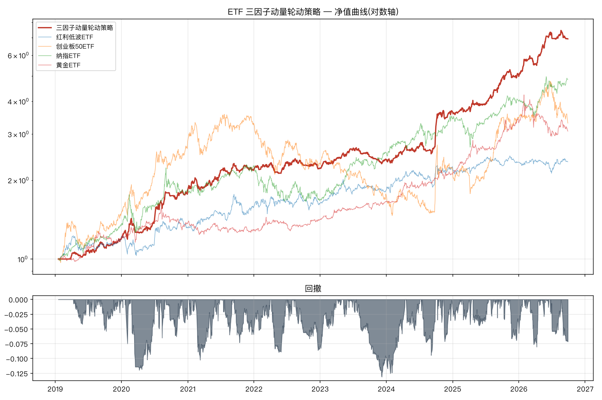
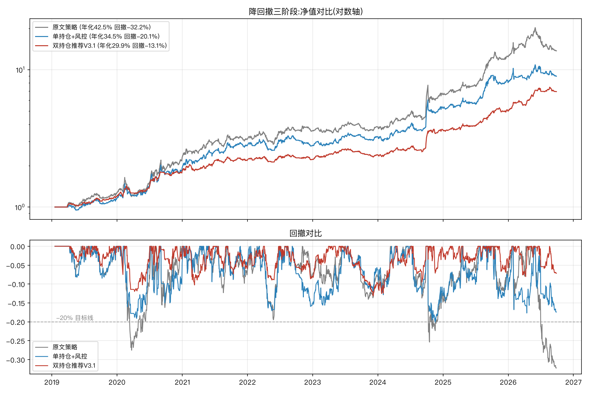

# ETF 三因子动量轮动策略

> 复现微信公众号文章《Claude Code 开发100个量化策略:ETF三因子动量轮动策略(7年13倍)》的完整可运行实现。
> 策略思想 100% 忠于原文:乖离/斜率/效率三动量因子 → Z-Score 标准化 → 0.3/0.3/0.4 加权 → 1.5 倍调仓阈值轮动。

## 回测结果(2019-01 → 2026-09,akshare 前复权数据)

| 指标 | 本项目 | 文章披露 |
|------|--------|---------|
| 年化收益 | **42.51%** | 聚宽 42% / QMT 43% |
| 净值终值 | **13.72 倍** | QMT 一度 13 倍 |
| 夏普比率 | **1.39** | > 1.3 |
| 最大回撤 | -32.20% | — |
| 调仓次数 / 胜率 | 125 次 / 53.6% | — |

> 这是**忠实原文**的全仓单标的版本(默认预设 `original`),用来对齐文章数字。
> 带风控的推荐版本见下文,年化降到 30% 但回撤从 -32% 压到 -13%。



## 快速开始

```bash
# 安装(建议虚拟环境,Python ≥ 3.11)
pip install -r requirements.txt

# 下载数据(akshare,缓存到 data/)
PYTHONPATH=src python -m etf_rotation.cli fetch

# 回测(输出指标 + 净值图 + 交易明细到 output/)
PYTHONPATH=src python -m etf_rotation.cli backtest

# 参数遍历(权重 × 阈值网格)
PYTHONPATH=src python -m etf_rotation.cli sweep --step 0.1

# 生成今日交易计划(盘前,对应文章 8:00 打印计划)
PYTHONPATH=src python -m etf_rotation.cli plan

# 开盘按真实开盘价成交最近一份计划(对应文章 9:30 实际交易;虚盘闭环)
PYTHONPATH=src python -m etf_rotation.cli execute

# 查看当前持仓/浮盈亏/权益/最近成交(纯离线)
PYTHONPATH=src python -m etf_rotation.cli dashboard --open   # 或生成 HTML 仪表盘并打开
PYTHONPATH=src python -m etf_rotation.cli status

# 运行测试
PYTHONPATH=src python -m pytest tests/ -q        # 107 passed
```

也可 `pip install -e .` 后直接使用 `etf-rotation <command>`。

## 策略逻辑(文章公式)

1. **乖离动量**:`bias = close / MA20`,取最近 25 天归一化后做线性回归,`得分 = 斜率 × 10000`
2. **斜率动量**:最近 25 天价格归一化做线性回归,`得分 = 10000 × 斜率 × R²`(强度×质量)
3. **效率动量**:中枢价 `(O+H+L+C)/4`,`得分 = 100×log收益 × (净位移/总波动)`(流畅度)
4. **Z-Score 标准化**后按 **0.3 / 0.3 / 0.4** 加权,选得分最高的 ETF
5. **1.5 倍调仓阈值**:挑战者得分须超过持仓得分的 1.5 倍才换仓,避免震荡期频繁交易

实盘机制(文章第 4 节)见 `src/etf_rotation/live.py`:盘前计划、限价单(买×1.01/卖×0.99)、状态持久化、复利盈亏。

**虚盘(模拟盘)闭环**:每晚 `cli fetch` + `cli plan` 生成计划,次日 9:30 后 `cli execute`
按真实开盘价成交并记账(限价单开盘价未成交则整批放弃、可稍候重跑;同一计划拒绝重复执行;
非交易日自动跳过)。`cli status` 随时查看持仓/浮盈亏/权益/最近成交(纯离线读缓存),
`cli dashboard --open` 生成网页仪表盘(浏览器直接看)。

**双轨对照(可选,B 轨 = 掘金仿真)**:同一信号源送掘金仿真账户真实撮合,仪表盘逐笔比较
两边成交价差。⚠️ 掘金 gmtrade SDK 仅 Windows/Linux 二进制(无 macOS 轮子),Mac 用户走
**手工路径**:sim.myquant.cn 网页创建仿真账户 → 每日网页手工下限价单(月均 ~3 次)→
定期"下载交易数据"CSV 后用 `scripts/gm_import_csv.py <文件>` 导入,双轨对照即激活;
Linux/Docker/云主机用户可直接挂 `scripts/gm_paper.py --token <token>` 全自动送单+同步。

**全自动挂机(macOS cron)**:`scripts/daily_paper.sh morning|evening` 已封装好每日任务,
`crontab -e` 加入下面四行即可(防止电脑到点休眠)。morning 含 fetch+plan+execute:
前一晚任务被睡眠错过时在这里自动补上(幂等守卫保证重复跑零副作用),10:31 / 21:30
为崩溃重试的补跑时隙:

```cron
31 9  * * 1-5  /Users/apple/Desktop/AIExp/etf-momentum-rotation/scripts/daily_paper.sh morning
31 10 * * 1-5  /Users/apple/Desktop/AIExp/etf-momentum-rotation/scripts/daily_paper.sh morning
30 20 * * *    /Users/apple/Desktop/AIExp/etf-momentum-rotation/scripts/daily_paper.sh evening
30 21 * * *    /Users/apple/Desktop/AIExp/etf-momentum-rotation/scripts/daily_paper.sh evening
```

> 注:选 cron 而非 launchd 是实测结论——launchd 子进程无 ~/Desktop 读权限
> (macOS TCC),cron 有,无需额外授权。

## 项目结构

```
etf-momentum-rotation/
├── src/etf_rotation/
│   ├── config.py      # 参数与股票池(文章披露值 + 显式假设)
│   ├── factors.py     # 三因子公式(文章代码的 numpy 等价实现)
│   ├── scoring.py     # Z-Score + 加权 + 1.5 倍阈值选股
│   ├── data.py        # akshare 数据获取 + CSV 缓存
│   ├── backtest.py    # 回测引擎(收盘评分→次日开盘成交,复利)
│   ├── metrics.py     # 年化/夏普/回撤/胜率
│   ├── report.py      # 净值图与交易明细导出
│   ├── live.py        # 实盘四机制(计划/限价单/持久化/复利)
│   ├── sweep.py       # 参数遍历
│   └── cli.py         # 命令行:fetch/backtest/sweep/plan
├── tests/             # 107 个单元与集成测试(含确定性无前视检验)
├── docs/
│   ├── article-notes.md   # 文章知识提取(公式/参数/忠实度对照)
│   └── development.md     # 开发过程记录
├── data/              # 行情缓存
├── output/            # 回测图表、交易明细、遍历结果
└── state/             # 实盘状态(持仓/日志/参数)
```

## 降回撤改良(扩展,默认关闭)

原文策略永远满仓单标的,震荡期回撤大(全周期 -32.2%)。本项目实现了一组可开关的风控机制
(`config.py` 风控扩展区,默认值 = 关闭 = 忠实原文),经 6 轮 60+ 组实验形成三档方案:

| 机制 | 参数 | 说明 |
|------|------|------|
| 固定止损+禁买期 | `stop_loss` / `stop_cooldown_days` | 对成本价浮亏超阈值强制离场,N 日内不买回 |
| **移动止损** | `trailing_stop` | 对**持仓期间最高价**回落超阈值离场(固定止损锚成本价,保护不了浮盈) |
| 绝对动量过滤 | `min_momentum` | regime 过滤(离场语义):近 N 天**原始收益** ≤ 阈值则离场/不建仓,全池无趋势时空仓观望(Z-Score 是相对值,表达不了"绝对无趋势") |
| 均线过滤 | `ma_filter_n` | regime 过滤:跌破自身 MA(n) 则离场/不建仓 |
| 入场确认 | `confirm_days` | 空仓时须连续 N 天评分第一才建仓(防震荡期假信号) |
| **分散持仓** | `n_hold` | 2=双标的等权,结构性稀释单标的事件风险(降回撤最强杠杆) |
| 溢价过滤 | `premium_max` | **入场门槛**(只拦新开仓):溢价超阈值不买,防溢价买入后坍塌套牢;已持有的不因此卖出(持有期离场归止损/止盈/轮动) |

### 三档方案(2019→2026 全周期)

| 方案 | 年化 | 最大回撤 | 夏普 | 卡玛 | 特点 |
|------|------|---------|------|------|------|
| V1(原文) | 42.51% | -32.20% | 1.39 | 1.32 | 文章原版,全仓单标的无风控 |
| 单持仓+风控 | 34.55% | -20.11% | 1.27 | 1.72 | `trail8+stop6+thr2+min_mom+confirm3`,收益优先 |
| V2(双持仓) | 23.64% | -13.10% | 1.33 | 1.80 | `n_hold=2 + trail8 + min_mom` |
| V3(双持仓+止盈) | 29.15% | -13.95% | 1.69 | 2.09 | V2 + `take_profit=0.25` |
| **V3.1(V3+溢价过滤,推荐)** | **29.92%** | **-13.10%** | 1.75 | **2.28** | V3 + `premium_max=0.07`(溢价>7%不开新仓,防溢价坍塌);OOS 年化 37.2% / 夏普 2.00 / 卡玛 2.84 |
| 双持仓极简 | 28.45% | -17.40% | 1.41 | 1.64 | 仅 `n_hold=2`,不加任何风控 |

**版本演进对照**(全周期 2019-01-18 → 2026-09-28,1864 个净值点;OOS = 2023-2026 样本外):

| 版本 | 年化 | 回撤 | 夏普 | 卡玛 | 总收益 | IS年化 | OOS年化 | OOS夏普 | OOS卡玛 |
|------|------|------|------|------|--------|--------|--------|--------|--------|
| V1(原文) | +42.51% | -32.20% | 1.39 | 1.32 | +1272% | +40.09% | +45.17% | 1.35 | 1.40 |
| V2 | +23.64% | -13.10% | 1.33 | 1.80 | +380% | +20.65% | +26.91% | 1.39 | 2.05 |
| V3 | +29.15% | -13.95% | 1.69 | 2.09 | +563% | +23.24% | +35.75% | 1.90 | 2.73 |
| **V3.1** | **+29.92%** | **-13.10%** | 1.75 | **2.28** | +592% | +23.45% | +37.16% | 2.00 | 2.84 |

> V1→V2:年化让 18.9pts,回撤减 59%,风险调整后大幅改善;V2→V3:止盈与移动止损形成
> "亏≤8%/盈收25%"的不对称赔率;V3→V3.1:溢价改**入场门槛**(第五轮口径,只拦新买不踢
> 持仓)后,年化(+0.77pt)、回撤(-0.85pt)、卡玛在全样本(2.09→2.28)、样本内
> (1.67→1.96)、样本外(2.73→2.84)同向改善 —— 但采纳它的主要理由仍是回测之外的
> 溢价坍塌风险,而非这段历史里的指标优势(数据 `output/versions_compare.csv`)。

### V3.1 随机 20 个一年期窗口回测(2026-09-29)

随机起点(种子 2026,可复现:`scripts/report_random20.py`),**20/20 窗口全部正收益**:

| 窗口 | 收益 | 回撤 | 夏普 | 卡玛 | | 窗口 | 收益 | 回撤 | 夏普 | 卡玛 |
|------|------|------|------|------|-|------|------|------|------|------|
| 2019-06-11~2020-06-10 | +27.7% | -12.0% | 1.69 | 2.40 | | 2024-02-17~2025-02-16 | +53.0% | -9.4% | 2.14 | 5.99 |
| 2019-07-18~2020-07-17 | +45.7% | -12.0% | 2.44 | 4.01 | | 2024-05-11~2025-05-11 | +50.0% | -9.4% | 2.00 | 5.62 |
| 2020-04-26~2021-04-26 | +53.2% | -10.2% | 2.56 | 5.46 | | 2024-06-15~2025-06-15 | +45.6% | -9.4% | 1.85 | 5.11 |
| 2020-07-06~2021-07-06 | +43.7% | -10.2% | 2.19 | 4.43 | | 2024-11-29~2025-11-29 | +43.5% | -6.6% | 2.59 | 6.89 |
| 2020-07-25~2021-07-25 | +42.9% | -10.2% | 2.27 | 4.39 | | 2024-12-01~2025-12-01 | +44.2% | -6.6% | 2.63 | 7.01 |
| 2020-08-27~2021-08-27 | +25.0% | -10.2% | 1.57 | 2.53 | | 2025-01-18~2026-01-18 | +44.0% | -6.9% | 2.60 | 6.74 |
| 2020-09-30~2021-09-30 | +25.6% | -10.2% | 1.57 | 2.62 | | 2025-02-25~2026-02-25 | +55.1% | -6.9% | 3.00 | 8.36 |
| 2021-12-01~2022-12-01 | +4.4% | -8.9% | 0.41 | 0.51 | | 2025-07-22~2026-07-22 | +68.7% | -8.0% | 3.23 | 9.02 |
| 2022-02-07~2023-02-07 | +4.9% | -8.9% | 0.45 | 0.57 | | 2025-08-27~2026-08-27 | +65.2% | -8.0% | 3.13 | 8.55 |
| 2022-08-20~2023-08-20 | +6.6% | -7.3% | 0.67 | 0.94 | | 2022-12-30~2023-12-30 | +7.7% | -13.1% | 0.82 | 0.61 |
| | | | | | | **汇总** | **均值+37.8%** | **最差-13.1%** | **均值1.99** | — |

**如何解读这张表(诚实版)**:
- 弱市窗口(2022 年)只有 +4~8%、夏普 0.4~0.8——全正靠的是 min_momentum 空仓过滤"少亏",不是"熊市也赚大钱";
- 2024 末~2026 窗口的卡玛 5~9 明显偏高,是纳指+黄金牛市 beta 加成,不代表常态;
- 窗口之间互相重叠且均在调参数据内,这是**样本内一致性**检验;真正的样本外证据是上表 OOS 列与审计报告的 walk-forward(见 `docs/audit-report.md`)。

> 表中数字为 **2026-09-29 第五轮的当前结果**(第五轮把溢价过滤改为入场门槛——只拦新买
> 不踢持仓——并修复"全池被筛掉时继续持有死扛"的漏洞,详见 `docs/audit-report.md` §十)。
> `output/rand10/`、`output/drawdown_experiments_r*.csv` 是第三轮及更早的**历史产物**,
> 数字对应修复前的引擎,仅供追溯,不要与上面的表横向比较。

V3 的固定止盈(+25% 离场+禁买期)在实验中发现与移动止损互补:
移动止损管"趋势延续中的回撤",止盈管"急涨后的均值回归",两者形成
"亏损 ≤8%、盈利收割 25%"的不对称赔率(约 3:1)。邻域 20~40% 为平台,
三个分时段(2019-2021/2022-2024/2025-至今)全部优于无止盈版。

```bash
# V3.1 推荐方案(溢价数据由 cli fetch 一并刷新;缺失/净值滞后会打警告)
PYTHONPATH=src python -m etf_rotation.cli fetch
PYTHONPATH=src python -m etf_rotation.cli backtest --preset v3.1
# V3(无溢价过滤)/ V2(不止盈)
PYTHONPATH=src python -m etf_rotation.cli backtest --preset v3
PYTHONPATH=src python -m etf_rotation.cli backtest --preset v2
```

> ⚠️ `cli backtest` **不加 `--preset` 时默认是 `original`**(忠实原文的 42%/-32% 全仓单标的版),
> 不是推荐配置;只有 `cli plan` 默认 `v3.1`。

实验脚本 `scripts/reduce_drawdown.py`,全部数据 `output/drawdown_experiments*.csv`。

注意:双持仓年调仓约 35 次,若券商有最低 5 元佣金,小资金账户的实际成本会高于回测假设(万1)。



> 上图由 `scripts/plot_drawdown_compare.py` 按第四轮修复后的引擎重绘(2026-09-29),三阶段 = 原文 / 单持仓+风控 / V3.1,图例数字与上方三档方案表同源。

## 重要假设(文章未披露,已在 config.py 标注)

- `BIAS_N = 20`(乖离率均线窗口,常用 MA20)
- `SLOPE_N = 25`、`效率窗口 = 25`(与文章给出的 MOMENTUM_DAY=25 对齐)
- 回测成交:信号日收盘评分 → **次日开盘价**成交(避免前视偏差);佣金双边万1

这些假设下回测结果与文章披露高度吻合(年化 42.51% vs 42~43%,净值 13.72x vs 13x),侧面验证了假设的合理性。

## 免责声明

本项目仅为对公开文章的学习复现,所有代码与结果不构成任何投资建议。投资有风险,入市需谨慎。
