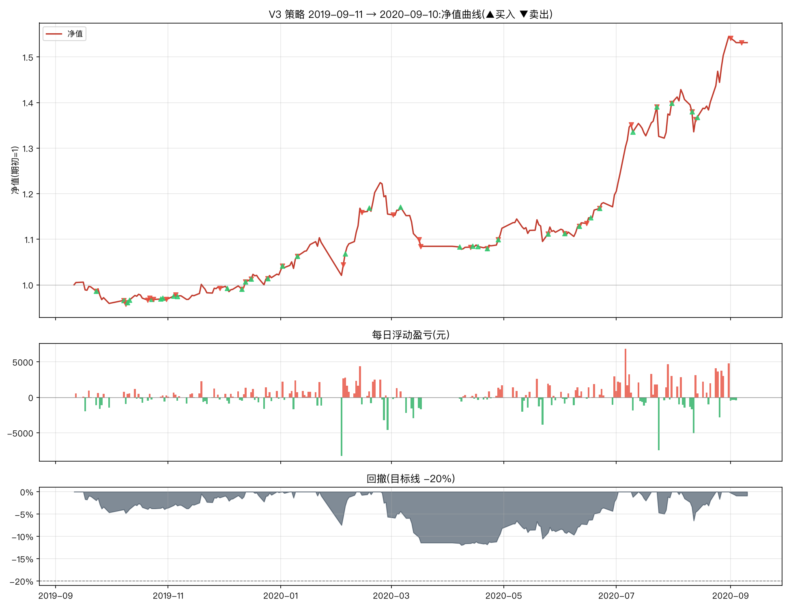

# V3 改良策略一年期报告(2019-09-11 → 2020-09-10)

参数:V3 = `n_hold=2, trailing_stop=0.08, min_momentum=0.0, take_profit=0.25`(其余同原文默认)
初始资金:100,000 元 | 佣金:双边 0.0100% | 数据:akshare 前复权



## 核心指标

```
总收益率     : 53.15%
年化收益     : 55.87%
年化波动     : 18.85%
夏普比率     : 2.45
最大回撤     : -11.96%
卡玛比率     : 4.67
回测天数     : 243
```

- 期末市值:**175,091 元**(期初 114,328 元)
- 持仓天数占比:90.9%(其余为空仓/半仓)
- 往返交易(窗口内完成):36 笔,胜率 **55.6%**,平均持有 18.3 天
- 单笔最大盈利:+21,008 元 | 单笔最大亏损:-3,979 元

## 月度收益

| 月份      |     月收益 |
|:--------|--------:|
| 2019-09 |  -4.08% |
| 2019-10 |  +0.99% |
| 2019-11 |  +2.46% |
| 2019-12 |  +2.95% |
| 2020-01 |  +6.97% |
| 2020-02 |  +5.69% |
| 2020-03 |  -6.13% |
| 2020-04 |  +3.65% |
| 2020-05 |  -0.79% |
| 2020-06 |  +7.35% |
| 2020-07 | +16.84% |
| 2020-08 | +10.46% |
| 2020-09 |  -0.89% |

## 往返交易明细

| 买入日        | 卖出日        | 标的               |   买入价 |      卖出价 |                  份额 |    盈亏(元) |         收益率 |   持有天数 |
|:-----------|:-----------|:-----------------|------:|---------:|--------------------:|---------:|------------:|-------:|
| 2019-09-09 | 2019-09-23 | 红利低波ETF(512890)  |    +1 |  +57.00% |  96520.24453072726  |  -579.12 | -0.0104167  |     14 |
| 2019-08-13 | 2019-10-08 | 创业板50ETF(159949) |    +1 |  +57.30% |  97555.67546346926  |  4487.56 |  0.0872865  |     56 |
| 2019-10-08 | 2019-10-09 | 红利低波ETF(512890)  |    +1 |  +56.20% |  98157.76881500082  |   196.32 |  0.00357143 |      1 |
| 2019-09-23 | 2019-10-10 | 纳指ETF(513100)    |    +1 |  +56.30% |  95165.28827820663  | -1427.48 | -0.0259516  |     17 |
| 2019-10-10 | 2019-10-21 | 红利低波ETF(512890)  |    +1 |  +56.90% |  96345.20922685976  |     0    |  0          |     11 |
| 2019-10-11 | 2019-10-22 | 纳指ETF(513100)    |    +1 |  +58.10% |  96685.05123471466  |  1353.59 |  0.0246914  |     11 |
| 2019-10-23 | 2019-10-24 | 红利低波ETF(512890)  |    +1 |  +57.10% |  96665.71519131823  |  -290    | -0.00522648 |      1 |
| 2019-10-29 | 2019-10-31 | 红利低波ETF(512890)  |    +1 |  +57.10% |  96235.83062725718  |  -384.94 | -0.00695652 |      2 |
| 2019-11-04 | 2019-11-05 | 创业板50ETF(159949) |    +1 |  +60.00% |  92180.65386881343  |   368.72 |  0.00671141 |      1 |
| 2019-11-06 | 2019-11-29 | 创业板50ETF(159949) |    +1 |  +60.10% |  91400.54743125243  |  -365.6  | -0.00661157 |     23 |
| 2019-12-03 | 2019-12-11 | 红利低波ETF(512890)  |    +1 |  +58.10% |  95847.71938865405  |   766.78 |  0.0139616  |      8 |
| 2019-12-11 | 2019-12-13 | 创业板50ETF(159949) |    +1 |  +63.10% |  88515.72021731366  |   177.03 |  0.00317965 |      2 |
| 2019-10-28 | 2019-12-16 | 纳指ETF(513100)    |    +1 |  +62.00% |  94590.77369345792  |  3310.68 |  0.0598291  |     49 |
| 2019-12-13 | 2019-12-25 | 红利低波ETF(512890)  |    +1 |  +58.80% |  95948.88201334655  |   575.69 |  0.0103093  |     12 |
| 2019-12-25 | 2020-01-02 | 纳指ETF(513100)    |    +1 |  +64.00% |  90378.83013421914  |   180.76 |  0.0031348  |      8 |
| 2020-01-02 | 2020-01-10 | 红利低波ETF(512890)  |    +1 |  +61.30% |  95905.27922730942  |   959.05 |  0.0165837  |      8 |
| 2019-12-16 | 2020-02-04 | 创业板50ETF(159949) |    +1 |  +66.00% |  89376.1946952326   |  1608.77 |  0.0280374  |     50 |
| 2020-01-10 | 2020-02-14 | 纳指ETF(513100)    |    +1 |  +82.70% |  88255.52367418433  | 14209.1  |  0.241742   |     35 |
| 2020-02-18 | 2020-03-02 | 创业板50ETF(159949) |    +1 |  +78.20% |  83050.61247493213  | -1494.91 | -0.0225     |     13 |
| 2020-03-06 | 2020-03-16 | 红利低波ETF(512890)  |    +1 |  +55.50% | 113688.11700470526  | -3979.08 | -0.059322   |     10 |
| 2020-02-05 | 2020-03-17 | 黄金ETF(518880)    |    +3 | +331.50% |  17050.156528197927 | -2455.22 | -0.0416305  |     41 |
| 2020-04-07 | 2020-04-13 | 黄金ETF(518880)    |    +4 | +367.50% |  16818.106919581027 |  -185    | -0.00298426 |      6 |
| 2020-04-17 | 2020-04-22 | 纳指ETF(513100)    |    +1 |  +65.80% |  92549.14196670853  |  -925.49 | -0.0149701  |      5 |
| 2020-04-14 | 2020-04-28 | 黄金ETF(518880)    |    +4 | +371.70% |  16736.84753170842  |   318    |  0.00513791 |     14 |
| 2020-04-22 | 2020-05-25 | 创业板50ETF(159949) |    +1 |  +76.90% |  81382.09865751828  |  1627.64 |  0.0267023  |     33 |
| 2020-04-28 | 2020-06-03 | 纳指ETF(513100)    |    +1 |  +75.00% |  86678.77417994227  |  2947.08 |  0.047486   |     36 |
| 2020-05-25 | 2020-06-11 | 黄金ETF(518880)    |    +4 | +384.40% |  16266.338868705954 |  -178.93 | -0.00285344 |     17 |
| 2020-06-11 | 2020-06-15 | 红利低波ETF(512890)  |    +1 |  +56.40% | 112125.89022088062  |  -448.5  | -0.00704225 |      4 |
| 2020-06-17 | 2020-06-22 | 纳指ETF(513100)    |    +1 |  +75.90% |  82974.21905059024  |  -248.92 | -0.00393701 |      5 |
| 2020-06-03 | 2020-07-09 | 创业板50ETF(159949) |    +1 | +104.60% |  78504.15190494688  | 18291.5  |  0.286593   |     36 |
| 2020-07-10 | 2020-07-23 | 黄金ETF(518880)    |    +4 | +405.60% |  19643.46081771486  |  2357.22 |  0.0304878  |     13 |
| 2020-06-22 | 2020-07-31 | 红利低波ETF(512890)  |    +1 |  +65.10% | 110078.38706769308  |  8696.19 |  0.138112   |     39 |
| 2020-07-23 | 2020-08-11 | 创业板50ETF(159949) |    +1 | +108.90% |  72809.84014496603  |   582.48 |  0.00740056 |     19 |
| 2020-07-31 | 2020-08-13 | 黄金ETF(518880)    |    +4 | +406.80% |  18507.405706666494 | -2091.34 | -0.027027   |     13 |
| 2020-08-11 | 2020-09-01 | 纳指ETF(513100)    |    +1 | +101.20% |  99092.57340947948  | 21007.6  |  0.265      |     21 |
| 2020-08-14 | 2020-09-07 | 红利低波ETF(512890)  |    +1 |  +67.00% | 111681.11208058991  |  -446.72 | -0.00593472 |     24 |

每日浮动盈亏明细见 `report_daily.csv`(共 243 个交易日);窗口相关委托流水(开仓回看 200 天)见 `report_trades.csv`。