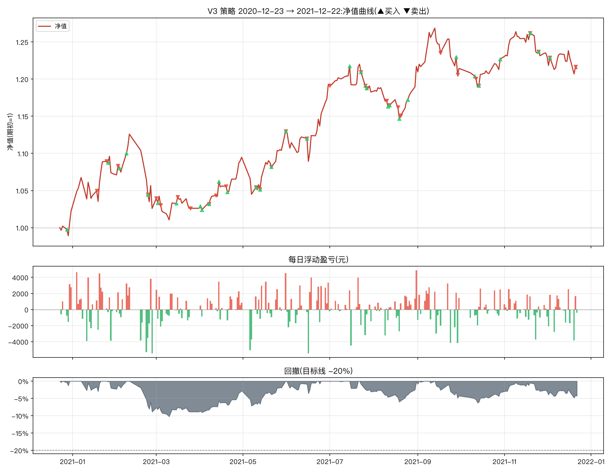

# V3 改良策略一年期报告(2020-12-23 → 2021-12-22)

参数:V3 = `n_hold=2, trailing_stop=0.08, min_momentum=0.0, take_profit=0.25`(其余同原文默认)
初始资金:100,000 元 | 佣金:双边 0.0100% | 数据:akshare 前复权



## 核心指标

```
总收益率     : 21.41%
年化收益     : 22.49%
年化波动     : 15.31%
夏普比率     : 1.40
最大回撤     : -10.24%
卡玛比率     : 2.20
回测天数     : 242
```

- 期末市值:**214,491 元**(期初 176,669 元)
- 持仓天数占比:97.1%(其余为空仓/半仓)
- 往返交易(窗口内完成):32 笔,胜率 **46.9%**,平均持有 18.3 天
- 单笔最大盈利:+23,591 元 | 单笔最大亏损:-5,177 元

## 月度收益

| 月份      |    月收益 |
|:--------|-------:|
| 2020-12 | +2.26% |
| 2021-01 | +4.92% |
| 2021-02 | -4.38% |
| 2021-03 | +0.02% |
| 2021-04 | +6.69% |
| 2021-05 | +3.20% |
| 2021-06 | +5.54% |
| 2021-07 | -0.83% |
| 2021-08 | +2.92% |
| 2021-09 | -0.22% |
| 2021-10 | +1.04% |
| 2021-11 | +0.68% |
| 2021-12 | -1.72% |

## 往返交易明细

| 买入日        | 卖出日        | 标的               |   买入价 |      卖出价 |                  份额 |    盈亏(元) |         收益率 |   持有天数 |
|:-----------|:-----------|:-----------------|------:|---------:|--------------------:|---------:|------------:|-------:|
| 2020-12-28 | 2021-01-18 | 黄金ETF(518880)    |    +4 | +374.10% |  22334.418186941333 | -2992.81 | -0.0345806  |     21 |
| 2020-12-16 | 2021-01-25 | 创业板50ETF(159949) |    +1 | +143.50% |  75917.43024069972  | 22395.6  |  0.258772   |     40 |
| 2021-01-26 | 2021-02-02 | 纳指ETF(513100)    |    +1 |  +88.20% | 107878.96515892982  | -1078.79 | -0.0112108  |      7 |
| 2021-02-08 | 2021-02-23 | 创业板50ETF(159949) |    +1 | +132.80% |  69433.3292068142   | -3471.67 | -0.0362845  |     15 |
| 2021-02-03 | 2021-03-01 | 纳指ETF(513100)    |    +1 |  +86.20% | 105839.74297233402  | -4445.27 | -0.0464602  |     26 |
| 2021-03-02 | 2021-03-04 | 纳指ETF(513100)    |    +1 |  +85.30% | 102952.15867133417  | -3397.42 | -0.037246   |      2 |
| 2021-03-15 | 2021-03-16 | 纳指ETF(513100)    |    +1 |  +87.20% | 101269.46780456821  |   506.35 |  0.00576701 |      1 |
| 2021-02-23 | 2021-03-25 | 红利低波ETF(512890)  |    +1 |  +69.70% | 133413.92274455362  |   800.48 |  0.00868307 |     30 |
| 2021-04-01 | 2021-04-07 | 红利低波ETF(512890)  |    +1 |  +70.80% | 127648.04408132851  |  -255.3  | -0.0028169  |      6 |
| 2021-04-07 | 2021-04-12 | 黄金ETF(518880)    |    +4 | +361.50% |  25085.158564765916 |   326.11 |  0.00360911 |      5 |
| 2021-04-14 | 2021-04-19 | 创业板50ETF(159949) |    +1 | +117.20% |  78294.22499897666  |  1096.12 |  0.0120898  |      5 |
| 2021-04-02 | 2021-05-10 | 纳指ETF(513100)    |    +1 |  +90.60% | 101036.91337541051  |   909.33 |  0.0100334  |     38 |
| 2021-05-10 | 2021-05-13 | 黄金ETF(518880)    |    +4 | +371.90% |  24576.0302214857   |  -122.88 | -0.00134264 |      3 |
| 2021-05-13 | 2021-05-21 | 红利低波ETF(512890)  |    +1 |  +73.30% | 123153.60870136003  | -1108.38 | -0.0121294  |      8 |
| 2021-05-21 | 2021-05-31 | 黄金ETF(518880)    |    +4 | +383.60% |  23682.377791072486 |   592.06 |  0.00655996 |     10 |
| 2021-05-31 | 2021-06-15 | 红利低波ETF(512890)  |    +1 |  +76.30% | 119039.88596955276  |     0    |  0          |     15 |
| 2021-04-20 | 2021-07-01 | 创业板50ETF(159949) |    +1 | +154.00% |  74891.82077556668  | 23590.9  |  0.257143   |     72 |
| 2021-06-15 | 2021-07-23 | 纳指ETF(513100)    |    +1 |  +99.20% |  98598.55419809352  |  7000.5  |  0.0770901  |     38 |
| 2021-07-23 | 2021-07-26 | 黄金ETF(518880)    |    +4 | +368.10% |  29059.007718312376 |   174.35 |  0.00163265 |      3 |
| 2021-07-15 | 2021-07-27 | 创业板50ETF(159949) |    +2 | +149.10% |  68986.82017622546  | -3449.34 | -0.0324465  |     12 |
| 2021-07-27 | 2021-08-10 | 黄金ETF(518880)    |    +4 | +355.70% |  28146.4151934429   | -3321.28 | -0.0321088  |     14 |
| 2021-08-11 | 2021-08-12 | 创业板50ETF(159949) |    +2 | +150.40% |  65637.23048162345  | -1378.38 | -0.0137705  |      1 |
| 2021-08-12 | 2021-08-18 | 红利低波ETF(512890)  |    +1 |  +74.50% | 132838.02416233747  |   265.68 |  0.00269179 |      6 |
| 2021-08-19 | 2021-08-20 | 红利低波ETF(512890)  |    +1 |  +73.90% | 132455.87165325906  | -1059.65 | -0.0107095  |      1 |
| 2021-07-26 | 2021-09-17 | 纳指ETF(513100)    |    +1 | +102.30% | 106133.25094306804  |  2228.8  |  0.0209581  |     53 |
| 2021-09-28 | 2021-09-29 | 创业板50ETF(159949) |    +1 | +140.30% |  75552.26706047099  | -1888.81 | -0.017507   |      1 |
| 2021-10-11 | 2021-10-12 | 创业板50ETF(159949) |    +1 | +141.00% |  74367.22200467793  | -1784.81 | -0.0167364  |      1 |
| 2021-08-25 | 2021-10-14 | 红利低波ETF(512890)  |    +1 |  +80.90% | 130140.0440861396   |  7417.98 |  0.0757979  |     50 |
| 2021-10-14 | 2021-11-19 | 创业板50ETF(159949) |    +1 | +150.40% |  74503.21013402665  |  7003.3  |  0.0666667  |     36 |
| 2021-11-19 | 2021-11-25 | 黄金ETF(518880)    |    +4 | +361.40% |  29778.0795154598   | -3573.37 | -0.0321371  |      6 |
| 2021-10-29 | 2021-12-03 | 纳指ETF(513100)    |    +1 | +104.50% | 102188.25514491982  |  1737.2  |  0.016537   |     35 |
| 2021-11-25 | 2021-12-21 | 创业板50ETF(159949) |    +2 | +147.60% |  69958.40421609477  | -5176.92 | -0.0477419  |     26 |

每日浮动盈亏明细见 `report_daily.csv`(共 242 个交易日);窗口相关委托流水(开仓回看 200 天)见 `report_trades.csv`。