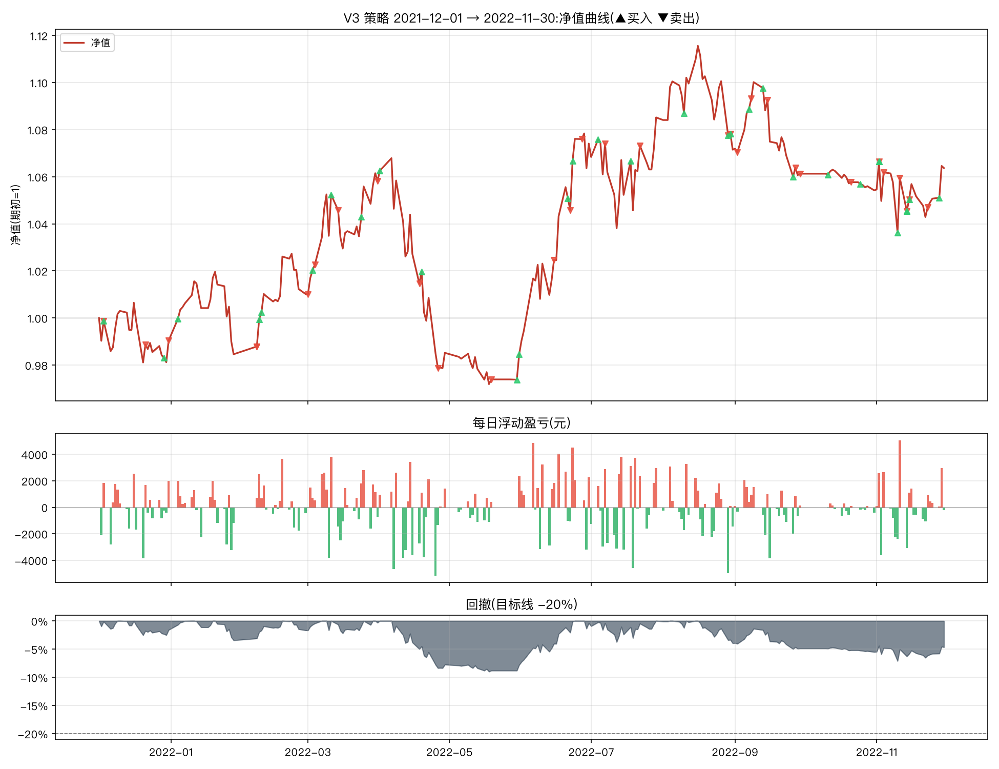

# V3 改良策略一年期报告(2021-12-01 → 2022-11-30)

参数:V3 = `n_hold=2, trailing_stop=0.08, min_momentum=0.0, take_profit=0.25`(其余同原文默认)
初始资金:100,000 元 | 佣金:双边 0.0100% | 数据:akshare 前复权



## 核心指标

```
总收益率     : 6.37%
年化收益     : 6.67%
年化波动     : 13.00%
夏普比率     : 0.56
最大回撤     : -8.99%
卡玛比率     : 0.74
回测天数     : 242
```

- 期末市值:**231,200 元**(期初 217,357 元)
- 持仓天数占比:94.6%(其余为空仓/半仓)
- 往返交易(窗口内完成):31 笔,胜率 **41.9%**,平均持有 17.3 天
- 单笔最大盈利:+20,689 元 | 单笔最大亏损:-5,787 元

## 月度收益

| 月份      |    月收益 |
|:--------|-------:|
| 2021-12 | -0.96% |
| 2022-01 | -0.59% |
| 2022-02 | +2.60% |
| 2022-03 | +4.75% |
| 2022-04 | -6.90% |
| 2022-05 | -0.06% |
| 2022-06 | +9.10% |
| 2022-07 | +1.04% |
| 2022-08 | -1.27% |
| 2022-09 | -0.95% |
| 2022-10 | -0.67% |
| 2022-11 | +0.90% |

## 往返交易明细

| 买入日        | 卖出日        | 标的               |   买入价 |      卖出价 |                  份额 |    盈亏(元) |          收益率 |   持有天数 |
|:-----------|:-----------|:-----------------|------:|---------:|--------------------:|---------:|-------------:|-------:|
| 2021-10-29 | 2021-12-03 | 纳指ETF(513100)    |    +1 | +104.50% | 102188.25514491982  |  1737.2  |  0.016537    |     35 |
| 2021-11-25 | 2021-12-21 | 创业板50ETF(159949) |    +2 | +147.60% |  69958.40421609477  | -5176.92 | -0.0477419   |     26 |
| 2021-12-29 | 2021-12-31 | 黄金ETF(518880)    |    +4 | +364.70% |  28526.652095777103 |   798.75 |  0.00773694  |      2 |
| 2021-12-03 | 2022-02-07 | 红利低波ETF(512890)  |    +1 |  +79.10% | 139928.40150587572  |  3918    |  0.0366972   |     66 |
| 2022-01-04 | 2022-02-07 | 黄金ETF(518880)    |    +4 | +362.00% |  28749.556078946225 |    57.5  |  0.000552792 |     34 |
| 2022-02-08 | 2022-03-01 | 红利低波ETF(512890)  |    +1 |  +81.80% | 132375.96140122146  |   926.63 |  0.00863132  |     21 |
| 2022-03-03 | 2022-03-04 | 红利低波ETF(512890)  |    +1 |  +84.40% | 129654.94706796322  |  1166.89 |  0.0107784   |      1 |
| 2022-03-11 | 2022-03-14 | 红利低波ETF(512890)  |    +1 |  +80.00% | 140265.2444417739   |  2805.3  |  0.025641    |      3 |
| 2022-02-09 | 2022-03-31 | 黄金ETF(518880)    |    +4 | +384.30% |  29388.69550955122  |  5583.85 |  0.052012    |     50 |
| 2022-03-24 | 2022-04-18 | 纳指ETF(513100)    |    +1 |  +89.80% | 119097.40364801529  | -5240.29 | -0.0467091   |     25 |
| 2022-04-01 | 2022-04-26 | 红利低波ETF(512890)  |    +1 |  +79.60% | 134586.61480482036  | -5787.22 | -0.0512515   |     25 |
| 2022-04-19 | 2022-05-19 | 黄金ETF(518880)    |    +4 | +385.20% |  27145.996357379343 | -2361.7  | -0.0220868   |     30 |
| 2022-05-30 | 2022-06-15 | 红利低波ETF(512890)  |    +1 |  +84.60% | 125091.59929406903  |     0    |  0           |     16 |
| 2022-06-21 | 2022-06-22 | 黄金ETF(518880)    |    +4 | +384.70% |  27419.440253202105 |  -329.03 | -0.00310961  |      1 |
| 2022-06-23 | 2022-06-27 | 黄金ETF(518880)    |    +4 | +384.20% |  27328.709819011026 |  -464.59 | -0.00440529  |      4 |
| 2022-07-04 | 2022-07-07 | 红利低波ETF(512890)  |    +1 |  +83.10% | 123646.5309705353   | -2225.64 | -0.0212014   |      3 |
| 2022-05-31 | 2022-07-22 | 创业板50ETF(159949) |    +1 | +122.30% | 103443.01234421531  | 20688.6  |  0.195503    |     52 |
| 2022-08-10 | 2022-08-29 | 黄金ETF(518880)    |    +4 | +375.50% |  31171.714694381128 | -1309.21 | -0.0110614   |     19 |
| 2022-07-18 | 2022-08-30 | 纳指ETF(513100)    |    +1 |  +87.80% | 123177.12015655899  |  5419.79 |  0.0527578   |     43 |
| 2022-08-30 | 2022-09-02 | 黄金ETF(518880)    |    +4 | +372.00% |  30920.843025704206 | -1978.93 | -0.0169133   |      3 |
| 2022-09-07 | 2022-09-08 | 黄金ETF(518880)    |    +4 | +378.60% |  30634.664917065504 |   980.31 |  0.00852424  |      1 |
| 2022-09-13 | 2022-09-15 | 黄金ETF(518880)    |    +4 | +375.20% |  30660.932302369965 |  -919.83 | -0.00793231  |      2 |
| 2022-09-26 | 2022-09-27 | 黄金ETF(518880)    |    +4 | +373.20% |  30769.612409120007 |  -184.62 | -0.00160514  |      1 |
| 2022-08-29 | 2022-09-29 | 红利低波ETF(512890)  |    +1 |  +84.10% | 137768.12211404275  |  -413.3  | -0.0035545   |     31 |
| 2022-10-11 | 2022-10-21 | 黄金ETF(518880)    |    +4 | +377.90% |  30316.646619197676 |  -757.92 | -0.00657203  |     10 |
| 2022-10-25 | 2022-11-02 | 黄金ETF(518880)    |    +4 | +381.60% |  29993.243624416395 |  -479.89 | -0.00417537  |      8 |
| 2022-11-02 | 2022-11-04 | 纳指ETF(513100)    |    +1 |  +80.10% | 136364.7072179219   | -5454.59 | -0.0475624   |      2 |
| 2022-11-02 | 2022-11-11 | 创业板50ETF(159949) |    +1 | +106.50% | 113322.84463465645  |  6006.11 |  0.0523715   |      9 |
| 2022-11-10 | 2022-11-14 | 黄金ETF(518880)    |    +4 | +394.80% |  27738.45210763029  |   305.12 |  0.00279401  |      4 |
| 2022-11-14 | 2022-11-15 | 创业板50ETF(159949) |    +1 | +103.70% | 109181.3096352678   | -1856.08 | -0.016129    |      1 |
| 2022-11-14 | 2022-11-23 | 纳指ETF(513100)    |    +1 |  +85.00% | 134435.86490136947  |  -806.62 | -0.00700935  |      9 |

每日浮动盈亏明细见 `report_daily.csv`(共 242 个交易日);窗口相关委托流水(开仓回看 200 天)见 `report_trades.csv`。