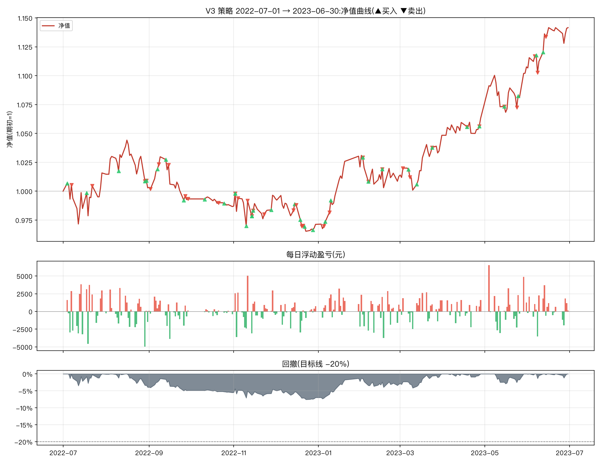

# V3 改良策略一年期报告(2022-07-01 → 2023-06-30)

参数:V3 = `n_hold=2, trailing_stop=0.08, min_momentum=0.0, take_profit=0.25`(其余同原文默认)
初始资金:100,000 元 | 佣金:双边 0.0100% | 数据:akshare 前复权



## 核心指标

```
总收益率     : 14.16%
年化收益     : 14.79%
年化波动     : 11.41%
夏普比率     : 1.27
最大回撤     : -7.55%
卡玛比率     : 1.96
回测天数     : 243
```

- 期末市值:**265,103 元**(期初 232,221 元)
- 持仓天数占比:97.5%(其余为空仓/半仓)
- 往返交易(窗口内完成):35 笔,胜率 **42.9%**,平均持有 15.6 天
- 单笔最大盈利:+20,689 元 | 单笔最大亏损:-5,455 元

## 月度收益

| 月份      |    月收益 |
|:--------|-------:|
| 2022-07 | +1.58% |
| 2022-08 | -1.27% |
| 2022-09 | -0.95% |
| 2022-10 | -0.67% |
| 2022-11 | +0.90% |
| 2022-12 | -2.44% |
| 2023-01 | +5.11% |
| 2023-02 | -0.81% |
| 2023-03 | +3.52% |
| 2023-04 | +1.42% |
| 2023-05 | +4.17% |
| 2023-06 | +3.07% |

## 往返交易明细

| 买入日        | 卖出日        | 标的               |   买入价 |      卖出价 |                  份额 |    盈亏(元) |         收益率 |   持有天数 |
|:-----------|:-----------|:-----------------|------:|---------:|--------------------:|---------:|------------:|-------:|
| 2022-07-04 | 2022-07-07 | 红利低波ETF(512890)  |    +1 |  +83.10% | 123646.5309705353   | -2225.64 | -0.0212014  |      3 |
| 2022-05-31 | 2022-07-22 | 创业板50ETF(159949) |    +1 | +122.30% | 103443.01234421531  | 20688.6  |  0.195503   |     52 |
| 2022-08-10 | 2022-08-29 | 黄金ETF(518880)    |    +4 | +375.50% |  31171.714694381128 | -1309.21 | -0.0110614  |     19 |
| 2022-07-18 | 2022-08-30 | 纳指ETF(513100)    |    +1 |  +87.80% | 123177.12015655899  |  5419.79 |  0.0527578  |     43 |
| 2022-08-30 | 2022-09-02 | 黄金ETF(518880)    |    +4 | +372.00% |  30920.843025704206 | -1978.93 | -0.0169133  |      3 |
| 2022-09-07 | 2022-09-08 | 黄金ETF(518880)    |    +4 | +378.60% |  30634.664917065504 |   980.31 |  0.00852424 |      1 |
| 2022-09-13 | 2022-09-15 | 黄金ETF(518880)    |    +4 | +375.20% |  30660.932302369965 |  -919.83 | -0.00793231 |      2 |
| 2022-09-26 | 2022-09-27 | 黄金ETF(518880)    |    +4 | +373.20% |  30769.612409120007 |  -184.62 | -0.00160514 |      1 |
| 2022-08-29 | 2022-09-29 | 红利低波ETF(512890)  |    +1 |  +84.10% | 137768.12211404275  |  -413.3  | -0.0035545  |     31 |
| 2022-10-11 | 2022-10-21 | 黄金ETF(518880)    |    +4 | +377.90% |  30316.646619197676 |  -757.92 | -0.00657203 |     10 |
| 2022-10-25 | 2022-11-02 | 黄金ETF(518880)    |    +4 | +381.60% |  29993.243624416395 |  -479.89 | -0.00417537 |      8 |
| 2022-11-02 | 2022-11-04 | 纳指ETF(513100)    |    +1 |  +80.10% | 136364.7072179219   | -5454.59 | -0.0475624  |      2 |
| 2022-11-02 | 2022-11-11 | 创业板50ETF(159949) |    +1 | +106.50% | 113322.84463465645  |  6006.11 |  0.0523715  |      9 |
| 2022-11-10 | 2022-11-14 | 黄金ETF(518880)    |    +4 | +394.80% |  27738.45210763029  |   305.12 |  0.00279401 |      4 |
| 2022-11-14 | 2022-11-15 | 创业板50ETF(159949) |    +1 | +103.70% | 109181.3096352678   | -1856.08 | -0.016129   |      1 |
| 2022-11-14 | 2022-11-23 | 纳指ETF(513100)    |    +1 |  +85.00% | 134435.86490136947  |  -806.62 | -0.00700935 |      9 |
| 2022-11-15 | 2022-12-14 | 黄金ETF(518880)    |    +4 | +396.50% |  28825.662088200796 |  1095.38 |  0.0096766  |     29 |
| 2022-12-15 | 2022-12-16 | 创业板50ETF(159949) |    +1 | +104.40% | 110603.63021356835  |  1216.64 |  0.0106486  |      1 |
| 2022-12-19 | 2022-12-20 | 创业板50ETF(159949) |    +1 | +102.50% | 110473.84580617752  | -1546.63 | -0.0134745  |      1 |
| 2022-11-28 | 2022-12-21 | 红利低波ETF(512890)  |    +1 |  +81.90% | 136009.08596647103  | -2856.19 | -0.025      |     23 |
| 2022-12-28 | 2023-01-05 | 创业板50ETF(159949) |    +1 | +102.20% | 109648.55630726446  |  -438.59 | -0.00389864 |      8 |
| 2022-12-22 | 2023-01-09 | 黄金ETF(518880)    |    +4 | +401.60% |  28249.852521511577 |   819.25 |  0.00727364 |     18 |
| 2023-01-10 | 2023-02-02 | 黄金ETF(518880)    |    +4 | +412.40% |  28339.732022671156 |  3429.11 |  0.0302273  |     23 |
| 2023-02-02 | 2023-02-06 | 红利低波ETF(512890)  |    +1 |  +84.30% | 137470.21343441657  |  -962.29 | -0.00823529 |      4 |
| 2023-01-06 | 2023-02-16 | 创业板50ETF(159949) |    +1 | +110.90% | 106916.99525866854  |  6415.02 |  0.0571973  |     41 |
| 2023-02-06 | 2023-03-03 | 纳指ETF(513100)    |    +1 |  +84.70% | 133177.25701850807  | -3063.08 | -0.0264368  |     25 |
| 2023-03-07 | 2023-03-08 | 黄金ETF(518880)    |    +4 | +403.20% |  27732.66353594181  | -1109.31 | -0.00982318 |      1 |
| 2023-02-16 | 2023-03-24 | 红利低波ETF(512890)  |    +1 |  +89.70% | 138477.66832165874  |  5816.06 |  0.0491228  |     36 |
| 2023-03-13 | 2023-04-18 | 黄金ETF(518880)    |    +4 | +430.10% |  27227.407909211637 |  5309.34 |  0.0474915  |     36 |
| 2023-03-24 | 2023-04-27 | 纳指ETF(513100)    |    +1 |  +90.50% | 135535.63026678847  |  2304.11 |  0.0191441  |     34 |
| 2023-04-27 | 2023-05-15 | 黄金ETF(518880)    |    +4 | +438.20% |  28264.649979069378 |  1695.88 |  0.0138825  |     18 |
| 2023-04-18 | 2023-05-24 | 红利低波ETF(512890)  |    +1 |  +92.40% | 130156.78011663514  |  -650.78 | -0.00538213 |     36 |
| 2023-05-25 | 2023-06-06 | 黄金ETF(518880)    |    +4 | +435.70% |  27788.49388894245  |   833.65 |  0.00693321 |     12 |
| 2023-06-07 | 2023-06-08 | 黄金ETF(518880)    |    +4 | +434.10% |  27712.97028188922  |  -748.25 | -0.00618132 |      1 |
| 2023-06-12 | 2023-06-14 | 黄金ETF(518880)    |    +4 | +436.20% |  27536.15952287143  |  -165.22 | -0.00137363 |      2 |

每日浮动盈亏明细见 `report_daily.csv`(共 243 个交易日);窗口相关委托流水(开仓回看 200 天)见 `report_trades.csv`。