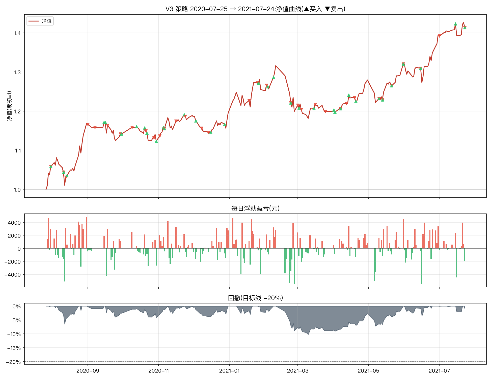

# V3 改良策略一年期报告(2020-07-25 → 2021-07-24)

参数:V3 = `n_hold=2, trailing_stop=0.08, min_momentum=0.0, take_profit=0.25`(其余同原文默认)
初始资金:100,000 元 | 佣金:双边 0.0100% | 数据:akshare 前复权



## 核心指标

```
总收益率     : 41.36%
年化收益     : 43.39%
年化波动     : 17.22%
夏普比率     : 2.18
最大回撤     : -10.24%
卡玛比率     : 4.24
回测天数     : 243
```

- 期末市值:**213,638 元**(期初 151,135 元)
- 持仓天数占比:92.6%(其余为空仓/半仓)
- 往返交易(窗口内完成):34 笔,胜率 **52.9%**,平均持有 16.8 天
- 单笔最大盈利:+23,591 元 | 单笔最大亏损:-4,445 元

## 月度收益

| 月份      |     月收益 |
|:--------|--------:|
| 2020-07 |  +5.82% |
| 2020-08 | +10.46% |
| 2020-09 |  -2.36% |
| 2020-10 |  -1.61% |
| 2020-11 |  +5.85% |
| 2020-12 |  +0.56% |
| 2021-01 |  +4.92% |
| 2021-02 |  -4.38% |
| 2021-03 |  +0.02% |
| 2021-04 |  +6.69% |
| 2021-05 |  +3.20% |
| 2021-06 |  +5.54% |
| 2021-07 |  +1.40% |

## 往返交易明细

| 买入日        | 卖出日        | 标的               |   买入价 |      卖出价 |                  份额 |    盈亏(元) |          收益率 |   持有天数 |
|:-----------|:-----------|:-----------------|------:|---------:|--------------------:|---------:|-------------:|-------:|
| 2020-06-22 | 2020-07-31 | 红利低波ETF(512890)  |    +1 |  +65.10% | 110078.38706769308  |  8696.19 |  0.138112    |     39 |
| 2020-07-23 | 2020-08-11 | 创业板50ETF(159949) |    +1 | +108.90% |  72809.84014496603  |   582.48 |  0.00740056  |     19 |
| 2020-07-31 | 2020-08-13 | 黄金ETF(518880)    |    +4 | +406.80% |  18507.405706666494 | -2091.34 | -0.027027    |     13 |
| 2020-08-11 | 2020-09-01 | 纳指ETF(513100)    |    +1 | +101.20% |  99092.57340947948  | 21007.6  |  0.265       |     21 |
| 2020-08-14 | 2020-09-07 | 红利低波ETF(512890)  |    +1 |  +67.00% | 111681.11208058991  |  -446.72 | -0.00593472  |     24 |
| 2020-09-16 | 2020-09-18 | 黄金ETF(518880)    |    +4 | +406.70% |  21470.813040175606 |  -214.71 | -0.00245278  |      2 |
| 2020-09-15 | 2020-09-29 | 纳指ETF(513100)    |    +1 |  +91.60% |  93024.9784960637   | -2325.62 | -0.0265675   |     14 |
| 2020-09-30 | 2020-10-09 | 纳指ETF(513100)    |    +1 |  +93.80% |  94675.17679842371  |  2556.23 |  0.0296378   |      9 |
| 2020-10-20 | 2020-10-21 | 红利低波ETF(512890)  |    +1 |  +66.40% | 130481.8456826933   |   260.96 |  0.00302115  |      1 |
| 2020-10-22 | 2020-10-28 | 红利低波ETF(512890)  |    +1 |  +65.00% | 130724.98003784192  | -1568.7  | -0.0181269   |      6 |
| 2020-10-30 | 2020-11-02 | 红利低波ETF(512890)  |    +1 |  +65.10% | 130570.09738348049  | -1175.13 | -0.0136364   |      3 |
| 2020-11-05 | 2020-11-06 | 黄金ETF(518880)    |    +4 | +400.20% |  21509.525188554246 |  1096.99 |  0.0129081   |      1 |
| 2020-10-13 | 2020-11-16 | 创业板50ETF(159949) |    +1 | +111.90% |  78281.14567315347  |    78.28 |  0.000894454 |     34 |
| 2020-11-23 | 2020-11-24 | 创业板50ETF(159949) |    +1 | +110.30% |  80127.24937220779  |   801.27 |  0.00914913  |      1 |
| 2020-12-03 | 2020-12-08 | 纳指ETF(513100)    |    +1 |  +86.10% | 100526.37186591269  | -1809.47 | -0.0204778   |      5 |
| 2020-11-06 | 2020-12-14 | 红利低波ETF(512890)  |    +1 |  +68.00% | 127313.4681086455   |   509.25 |  0.00591716  |     38 |
| 2020-12-28 | 2021-01-18 | 黄金ETF(518880)    |    +4 | +374.10% |  22334.418186941333 | -2992.81 | -0.0345806   |     21 |
| 2020-12-16 | 2021-01-25 | 创业板50ETF(159949) |    +1 | +143.50% |  75917.43024069972  | 22395.6  |  0.258772    |     40 |
| 2021-01-26 | 2021-02-02 | 纳指ETF(513100)    |    +1 |  +88.20% | 107878.96515892982  | -1078.79 | -0.0112108   |      7 |
| 2021-02-08 | 2021-02-23 | 创业板50ETF(159949) |    +1 | +132.80% |  69433.3292068142   | -3471.67 | -0.0362845   |     15 |
| 2021-02-03 | 2021-03-01 | 纳指ETF(513100)    |    +1 |  +86.20% | 105839.74297233402  | -4445.27 | -0.0464602   |     26 |
| 2021-03-02 | 2021-03-04 | 纳指ETF(513100)    |    +1 |  +85.30% | 102952.15867133417  | -3397.42 | -0.037246    |      2 |
| 2021-03-15 | 2021-03-16 | 纳指ETF(513100)    |    +1 |  +87.20% | 101269.46780456821  |   506.35 |  0.00576701  |      1 |
| 2021-02-23 | 2021-03-25 | 红利低波ETF(512890)  |    +1 |  +69.70% | 133413.92274455362  |   800.48 |  0.00868307  |     30 |
| 2021-04-01 | 2021-04-07 | 红利低波ETF(512890)  |    +1 |  +70.80% | 127648.04408132851  |  -255.3  | -0.0028169   |      6 |
| 2021-04-07 | 2021-04-12 | 黄金ETF(518880)    |    +4 | +361.50% |  25085.158564765916 |   326.11 |  0.00360911  |      5 |
| 2021-04-14 | 2021-04-19 | 创业板50ETF(159949) |    +1 | +117.20% |  78294.22499897666  |  1096.12 |  0.0120898   |      5 |
| 2021-04-02 | 2021-05-10 | 纳指ETF(513100)    |    +1 |  +90.60% | 101036.91337541051  |   909.33 |  0.0100334   |     38 |
| 2021-05-10 | 2021-05-13 | 黄金ETF(518880)    |    +4 | +371.90% |  24576.0302214857   |  -122.88 | -0.00134264  |      3 |
| 2021-05-13 | 2021-05-21 | 红利低波ETF(512890)  |    +1 |  +73.30% | 123153.60870136003  | -1108.38 | -0.0121294   |      8 |
| 2021-05-21 | 2021-05-31 | 黄金ETF(518880)    |    +4 | +383.60% |  23682.377791072486 |   592.06 |  0.00655996  |     10 |
| 2021-05-31 | 2021-06-15 | 红利低波ETF(512890)  |    +1 |  +76.30% | 119039.88596955276  |     0    |  0           |     15 |
| 2021-04-20 | 2021-07-01 | 创业板50ETF(159949) |    +1 | +154.00% |  74891.82077556668  | 23590.9  |  0.257143    |     72 |
| 2021-06-15 | 2021-07-23 | 纳指ETF(513100)    |    +1 |  +99.20% |  98598.55419809352  |  7000.5  |  0.0770901   |     38 |

每日浮动盈亏明细见 `report_daily.csv`(共 243 个交易日);窗口相关委托流水(开仓回看 200 天)见 `report_trades.csv`。