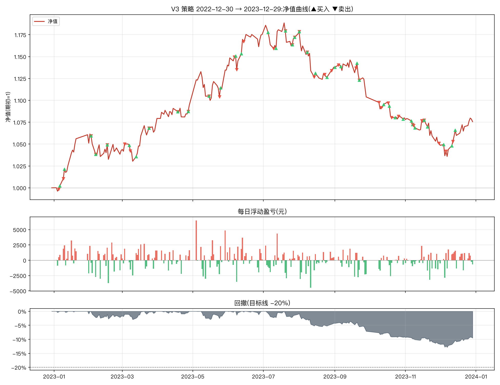

# V3 改良策略一年期报告(2022-12-30 → 2023-12-29)

参数:V3 = `n_hold=2, trailing_stop=0.08, min_momentum=0.0, take_profit=0.25`(其余同基础版默认)
初始资金:100,000 元 | 佣金:双边 0.0100% | 数据:akshare 前复权



## 核心指标

```
总收益率     : 7.56%
年化收益     : 7.88%
年化波动     : 9.78%
夏普比率     : 0.82
最大回撤     : -12.84%
卡玛比率     : 0.61
回测天数     : 243
```

- 期末市值:**242,607 元**(期初 225,565 元)
- 持仓天数占比:97.5%(其余为空仓/半仓)
- 往返交易(窗口内完成):39 笔,胜率 **41.0%**,平均持有 14.8 天
- 单笔最大盈利:+25,046 元 | 单笔最大亏损:-5,120 元

## 月度收益

| 月份      |    月收益 |
|:--------|-------:|
| 2022-12 | +0.00% |
| 2023-01 | +5.11% |
| 2023-02 | -0.81% |
| 2023-03 | +3.52% |
| 2023-04 | +1.42% |
| 2023-05 | +4.17% |
| 2023-06 | +3.07% |
| 2023-07 | +0.06% |
| 2023-08 | -3.23% |
| 2023-09 | -2.99% |
| 2023-10 | -2.17% |
| 2023-11 | -2.69% |
| 2023-12 | +2.35% |

## 往返交易明细

| 买入日        | 卖出日        | 标的               |   买入价 |      卖出价 |                  份额 |    盈亏(元) |          收益率 |   持有天数 |
|:-----------|:-----------|:-----------------|------:|---------:|--------------------:|---------:|-------------:|-------:|
| 2022-12-28 | 2023-01-05 | 创业板50ETF(159949) |    +1 | +102.20% | 109648.55630726446  |  -438.59 | -0.00389864  |      8 |
| 2022-12-22 | 2023-01-09 | 黄金ETF(518880)    |    +4 | +401.60% |  28249.852521511577 |   819.25 |  0.00727364  |     18 |
| 2023-01-10 | 2023-02-02 | 黄金ETF(518880)    |    +4 | +412.40% |  28339.732022671156 |  3429.11 |  0.0302273   |     23 |
| 2023-02-02 | 2023-02-06 | 红利低波ETF(512890)  |    +1 |  +84.30% | 137470.21343441657  |  -962.29 | -0.00823529  |      4 |
| 2023-01-06 | 2023-02-16 | 创业板50ETF(159949) |    +1 | +110.90% | 106916.99525866854  |  6415.02 |  0.0571973   |     41 |
| 2023-02-06 | 2023-03-03 | 纳指ETF(513100)    |    +1 |  +84.70% | 133177.25701850807  | -3063.08 | -0.0264368   |     25 |
| 2023-03-07 | 2023-03-08 | 黄金ETF(518880)    |    +4 | +403.20% |  27732.66353594181  | -1109.31 | -0.00982318  |      1 |
| 2023-02-16 | 2023-03-24 | 红利低波ETF(512890)  |    +1 |  +89.70% | 138477.66832165874  |  5816.06 |  0.0491228   |     36 |
| 2023-03-13 | 2023-04-18 | 黄金ETF(518880)    |    +4 | +430.10% |  27227.407909211637 |  5309.34 |  0.0474915   |     36 |
| 2023-03-24 | 2023-04-27 | 纳指ETF(513100)    |    +1 |  +90.50% | 135535.63026678847  |  2304.11 |  0.0191441   |     34 |
| 2023-04-27 | 2023-05-15 | 黄金ETF(518880)    |    +4 | +438.20% |  28264.649979069378 |  1695.88 |  0.0138825   |     18 |
| 2023-04-18 | 2023-05-24 | 红利低波ETF(512890)  |    +1 |  +92.40% | 130156.78011663514  |  -650.78 | -0.00538213  |     36 |
| 2023-05-25 | 2023-06-06 | 黄金ETF(518880)    |    +4 | +435.70% |  27788.49388894245  |   833.65 |  0.00693321  |     12 |
| 2023-06-07 | 2023-06-08 | 黄金ETF(518880)    |    +4 | +434.10% |  27712.97028188922  |  -748.25 | -0.00618132  |      1 |
| 2023-06-12 | 2023-06-14 | 黄金ETF(518880)    |    +4 | +436.20% |  27536.15952287143  |  -165.22 | -0.00137363  |      2 |
| 2023-07-05 | 2023-07-10 | 创业板50ETF(159949) |    +1 |  +92.20% | 127077.9962902907   | -2922.79 | -0.0243386   |      5 |
| 2023-07-12 | 2023-07-20 | 创业板50ETF(159949) |    +1 |  +92.40% | 124487.22695939557  | -2116.28 | -0.0180659   |      8 |
| 2023-07-20 | 2023-07-26 | 黄金ETF(518880)    |    +4 | +442.50% |  25687.5572082201   | -1335.75 | -0.0116149   |      6 |
| 2023-05-15 | 2023-07-28 | 纳指ETF(513100)    |    +1 | +113.30% | 131820.06762144456  | 25045.8  |  0.201485    |     74 |
| 2023-07-28 | 2023-08-01 | 黄金ETF(518880)    |    +4 | +442.30% |  29725.810736720367 |    59.45 |  0.000452386 |      4 |
| 2023-08-01 | 2023-08-08 | 纳指ETF(513100)    |    +1 | +112.30% | 115390.36244922783  | -3230.93 | -0.0243267   |      7 |
| 2023-08-08 | 2023-08-14 | 创业板50ETF(159949) |    +1 |  +92.10% | 136442.28947474743  | -4502.6  | -0.0345912   |      6 |
| 2023-08-15 | 2023-08-23 | 黄金ETF(518880)    |    +4 | +444.00% |  28740.585812465448 |   546.07 |  0.00429767  |      8 |
| 2023-07-26 | 2023-08-29 | 红利低波ETF(512890)  |    +1 |  +94.50% | 120004.97180033695  |  -240.01 | -0.00211193  |     34 |
| 2023-09-01 | 2023-09-04 | 纳指ETF(513100)    |    +1 | +114.00% | 112491.66520608353  |   224.98 |  0.00175747  |      3 |
| 2023-09-06 | 2023-09-19 | 纳指ETF(513100)    |    +1 | +112.60% | 112191.47179377492  | -2243.83 | -0.017452    |     13 |
| 2023-09-20 | 2023-09-22 | 纳指ETF(513100)    |    +1 | +108.50% | 112692.72589876516  | -4169.63 | -0.0329768   |      2 |
| 2023-08-25 | 2023-10-09 | 黄金ETF(518880)    |    +4 | +440.00% |  28518.06521701684  | -1482.94 | -0.0116801   |     45 |
| 2023-09-22 | 2023-10-11 | 红利低波ETF(512890)  |    +1 |  +93.90% | 128681.21526458552  | -1415.49 | -0.0115789   |     19 |
| 2023-10-13 | 2023-10-17 | 红利低波ETF(512890)  |    +1 |  +95.00% | 130851.1627639818   |  1177.66 |  0.00956429  |      4 |
| 2023-10-18 | 2023-10-20 | 红利低波ETF(512890)  |    +1 |  +92.80% | 129265.77236617057  | -3748.71 | -0.030303    |      2 |
| 2023-10-23 | 2023-10-26 | 黄金ETF(518880)    |    +5 | +458.40% |  26656.67290836616  |   373.19 |  0.00306346  |      3 |
| 2023-11-06 | 2023-11-07 | 纳指ETF(513100)    |    +1 | +111.20% | 109568.3095584523   |   219.14 |  0.0018018   |      1 |
| 2023-10-30 | 2023-11-08 | 黄金ETF(518880)    |    +5 | +456.10% |  26320.468844380084 | -1947.71 | -0.0159655   |      9 |
| 2023-11-07 | 2023-11-15 | 创业板50ETF(159949) |    +1 |  +84.90% | 142336.62594725352  |  -427.01 | -0.00352113  |      8 |
| 2023-11-09 | 2023-11-17 | 黄金ETF(518880)    |    +5 | +457.80% |  26631.016096739375 |  1171.76 |  0.00970446  |      8 |
| 2023-11-20 | 2023-11-30 | 创业板50ETF(159949) |    +1 |  +79.30% | 146298.127993343    | -5120.43 | -0.0422705   |     10 |
| 2023-12-04 | 2023-12-06 | 红利低波ETF(512890)  |    +1 |  +91.20% | 125335.52033531149  | -2005.37 | -0.0172414   |      2 |
| 2023-12-11 | 2023-12-12 | 黄金ETF(518880)    |    +5 | +454.30% |  25133.744114791043 |  -100.53 | -0.000879701 |      1 |

每日浮动盈亏明细见 `report_daily.csv`(共 243 个交易日);窗口相关委托流水(开仓回看 200 天)见 `report_trades.csv`。