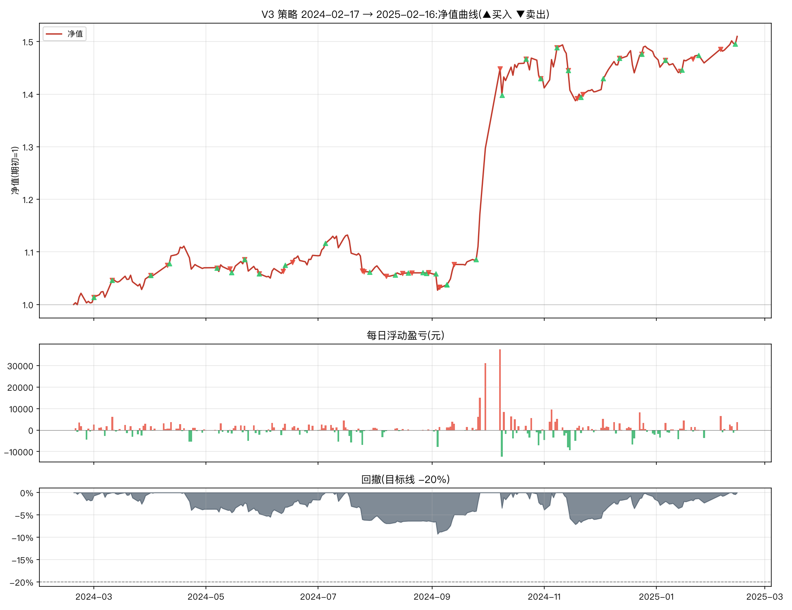

# V3 改良策略一年期报告(2024-02-17 → 2025-02-16)

参数:V3 = `n_hold=2, trailing_stop=0.08, min_momentum=0.0, take_profit=0.25`(其余同基础版默认)
初始资金:100,000 元 | 佣金:双边 0.0100% | 数据:akshare 前复权



## 核心指标

```
总收益率     : 50.99%
年化收益     : 54.41%
年化波动     : 22.08%
夏普比率     : 2.08
最大回撤     : -9.27%
卡玛比率     : 5.87
回测天数     : 240
```

- 期末市值:**373,107 元**(期初 247,103 元)
- 持仓天数占比:95.4%(其余为空仓/半仓)
- 往返交易(窗口内完成):32 笔,胜率 **53.1%**,平均持有 19.1 天
- 单笔最大盈利:+89,695 元 | 单笔最大亏损:-16,286 元

## 月度收益

| 月份      |     月收益 |
|:--------|--------:|
| 2024-02 |  +0.38% |
| 2024-03 |  +4.46% |
| 2024-04 |  +2.03% |
| 2024-05 |  -1.19% |
| 2024-06 |  +3.44% |
| 2024-07 |  -2.45% |
| 2024-08 |  -0.57% |
| 2024-09 | +22.28% |
| 2024-10 | +10.30% |
| 2024-11 |  -1.79% |
| 2024-12 |  +4.79% |
| 2025-01 |  -0.87% |
| 2025-02 |  +3.46% |

## 往返交易明细

| 买入日        | 卖出日        | 标的               |   买入价 |      卖出价 |                  份额 |     盈亏(元) |          收益率 |   持有天数 |
|:-----------|:-----------|:-----------------|------:|---------:|--------------------:|----------:|-------------:|-------:|
| 2024-01-23 | 2024-03-01 | 纳指ETF(513100)    |    +1 | +131.40% |  92341.41567057352  |   3416.63 |  0.0289742   |     38 |
| 2024-01-25 | 2024-03-11 | 红利低波ETF(512890)  |    +1 | +102.40% | 127424.78456342412  |  12615    |  0.107027    |     46 |
| 2024-03-01 | 2024-04-01 | 创业板50ETF(159949) |    +1 |  +77.90% | 159690.02127712718  |   3034.11 |  0.025       |     31 |
| 2024-04-01 | 2024-04-10 | 纳指ETF(513100)    |    +1 | +133.10% |  95487.93846160015  |  -1432.32 | -0.0111441   |      9 |
| 2024-03-11 | 2024-05-07 | 黄金ETF(518880)    |    +5 | +527.80% |  25713.307623399036 |   9411.07 |  0.0745114   |     57 |
| 2024-05-07 | 2024-05-14 | 创业板50ETF(159949) |    +1 |  +79.20% | 162631.93416525796  |  -3740.53 | -0.0282209   |      7 |
| 2024-04-11 | 2024-05-22 | 红利低波ETF(512890)  |    +1 | +108.90% | 123487.87995540893  |   7409.27 |  0.058309    |     41 |
| 2024-05-15 | 2024-05-30 | 创业板50ETF(159949) |    +1 |  +77.00% | 166801.46718623806  |  -3336.03 | -0.0253165   |     15 |
| 2024-05-30 | 2024-06-12 | 红利低波ETF(512890)  |    +1 | +105.30% | 119363.27987305909  |  -4058.35 | -0.0312787   |     13 |
| 2024-06-13 | 2024-06-17 | 黄金ETF(518880)    |    +5 | +530.20% |  23886.028712504332 |    979.33 |  0.0077932   |      4 |
| 2024-05-22 | 2024-07-25 | 纳指ETF(513100)    |    +1 | +141.00% |  97343.46835533027  |   3991.08 |  0.0299489   |     64 |
| 2024-07-05 | 2024-07-26 | 黄金ETF(518880)    |    +5 | +531.20% |  23600.819525682844 |  -1250.84 | -0.00987884  |     21 |
| 2024-07-29 | 2024-08-07 | 黄金ETF(518880)    |    +5 | +530.70% |  24334.50620564607  |  -2141.44 | -0.0163114   |      9 |
| 2024-08-12 | 2024-08-16 | 黄金ETF(518880)    |    +5 | +546.50% |  24066.73364689185  |   1323.67 |  0.0101664   |      4 |
| 2024-08-19 | 2024-08-21 | 黄金ETF(518880)    |    +6 | +551.40% |  23782.208722766252 |    285.39 |  0.00218103  |      2 |
| 2024-08-29 | 2024-08-30 | 纳指ETF(513100)    |    +1 | +141.30% |  92893.11545445552  |    278.68 |  0.00212766  |      1 |
| 2024-08-27 | 2024-09-05 | 黄金ETF(518880)    |    +6 | +548.30% |  23693.79392018493  |  -1066.22 | -0.00814038  |      9 |
| 2024-09-03 | 2024-09-05 | 纳指ETF(513100)    |    +1 | +136.60% |  91265.85495670434  |  -5932.28 | -0.0454228   |      2 |
| 2024-09-09 | 2024-09-13 | 纳指ETF(513100)    |    +1 | +143.20% |  94574.35116653869  |   7849.67 |  0.0615271   |      4 |
| 2024-09-25 | 2024-10-08 | 创业板50ETF(159949) |    +1 | +121.10% | 184938.01568702149  |  89694.9  |  0.668044    |     13 |
| 2024-09-09 | 2024-10-22 | 黄金ETF(518880)    |    +5 | +601.80% |  23259.94525499739  |  12397.5  |  0.0971741   |     43 |
| 2024-10-09 | 2024-10-30 | 红利低波ETF(512890)  |    +1 | +107.10% | 159199.03443260264  |  -7959.95 | -0.044603    |     21 |
| 2024-10-22 | 2024-11-08 | 创业板50ETF(159949) |    +1 | +107.60% | 182977.11153308555  |  17016.9  |  0.0946083   |     17 |
| 2024-10-30 | 2024-11-14 | 黄金ETF(518880)    |    +6 | +572.40% |  28864.65393941387  | -11170.6  | -0.0633284   |     15 |
| 2024-11-14 | 2024-11-19 | 创业板50ETF(159949) |    +1 |  +98.60% | 164500.4318278078   | -16285.5  | -0.0912442   |      5 |
| 2024-11-21 | 2024-11-22 | 红利低波ETF(512890)  |    +1 | +109.70% | 147691.2458279019   |   -147.69 | -0.000910747 |      1 |
| 2024-12-03 | 2024-12-12 | 红利低波ETF(512890)  |    +1 | +112.10% | 149020.14244162533  |   5066.68 |  0.0312787   |      9 |
| 2024-12-12 | 2024-12-24 | 黄金ETF(518880)    |    +6 | +592.80% |  27661.174400735737 |  -3042.73 | -0.018218    |     12 |
| 2024-12-24 | 2025-01-06 | 红利低波ETF(512890)  |    +1 | +108.50% | 148498.7757236833   |  -2821.48 | -0.0172101   |     13 |
| 2024-11-08 | 2025-01-14 | 纳指ETF(513100)    |    +2 | +160.90% | 120852.92083354201  |  10151.6  |  0.055082    |     67 |
| 2025-01-15 | 2025-01-21 | 纳指ETF(513100)    |    +2 | +164.10% | 111315.32597922922  |   4229.98 |  0.0237056   |      6 |
| 2025-01-24 | 2025-02-05 | 纳指ETF(513100)    |    +2 | +161.70% | 110501.19456870199  |  -3646.54 | -0.02        |     12 |

每日浮动盈亏明细见 `report_daily.csv`(共 240 个交易日);窗口相关委托流水(开仓回看 200 天)见 `report_trades.csv`。