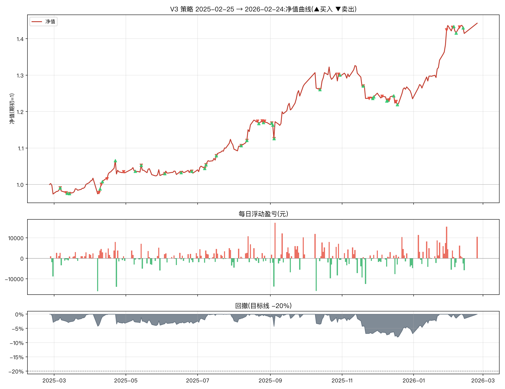

# V3 改良策略一年期报告(2025-02-25 → 2026-02-24)

参数:V3 = `n_hold=2, trailing_stop=0.08, min_momentum=0.0, take_profit=0.25`(其余同基础版默认)
初始资金:100,000 元 | 佣金:双边 0.0100% | 数据:akshare 前复权



## 核心指标

```
总收益率     : 44.25%
年化收益     : 46.68%
年化波动     : 16.17%
夏普比率     : 2.45
最大回撤     : -8.05%
卡玛比率     : 5.80
回测天数     : 242
```

- 期末市值:**540,336 元**(期初 374,590 元)
- 持仓天数占比:99.6%(其余为空仓/半仓)
- 往返交易(窗口内完成):33 笔,胜率 **45.5%**,平均持有 21.4 天
- 单笔最大盈利:+74,932 元 | 单笔最大亏损:-8,206 元

## 月度收益

| 月份      |     月收益 |
|:--------|--------:|
| 2025-02 |  -2.61% |
| 2025-03 |  +3.25% |
| 2025-04 |  +2.62% |
| 2025-05 |  -0.70% |
| 2025-06 |  +1.26% |
| 2025-07 |  +6.90% |
| 2025-08 |  +5.49% |
| 2025-09 |  +8.96% |
| 2025-10 |  +1.85% |
| 2025-11 |  -4.47% |
| 2025-12 |  -0.43% |
| 2026-01 | +16.28% |
| 2026-02 |  +0.43% |

## 往返交易明细

| 买入日        | 卖出日        | 标的               |   买入价 |       卖出价 |                  份额 |    盈亏(元) |         收益率 |   持有天数 |
|:-----------|:-----------|:-----------------|------:|----------:|--------------------:|---------:|------------:|-------:|
| 2025-01-06 | 2025-03-06 | 黄金ETF(518880)    |    +6 |  +653.00% |  26745.63324540529  | 13560    |  0.0841773  |     59 |
| 2025-03-06 | 2025-03-11 | 红利低波ETF(512890)  |    +1 |  +107.60% | 168933.0757076758   | -2534    | -0.0137489  |      5 |
| 2025-02-13 | 2025-03-14 | 创业板50ETF(159949) |    +1 |   +95.20% | 190764.89118875843  | -3624.53 | -0.0195675  |     29 |
| 2025-03-12 | 2025-04-08 | 红利低波ETF(512890)  |    +1 |  +106.50% | 167652.8015510025   | -3185.4  | -0.0175277  |     27 |
| 2025-04-09 | 2025-04-10 | 红利低波ETF(512890)  |    +1 |  +108.80% | 165905.69274218366  |  1990.87 |  0.0111524  |      1 |
| 2025-04-11 | 2025-04-15 | 红利低波ETF(512890)  |    +1 |  +109.50% | 166025.10987102953  |  1328.2  |  0.00735971 |      4 |
| 2025-04-22 | 2025-04-29 | 红利低波ETF(512890)  |    +1 |  +112.80% | 163014.47320869105  |  2119.19 |  0.0116592  |      7 |
| 2025-03-14 | 2025-05-14 | 黄金ETF(518880)    |    +7 |  +730.90% |  27128.62043814395  | 16711.2  |  0.0920365  |     61 |
| 2025-05-14 | 2025-06-03 | 创业板50ETF(159949) |    +1 |   +87.90% | 212906.92175950078  | -7664.65 | -0.0393443  |     20 |
| 2025-05-09 | 2025-06-17 | 纳指ETF(513100)    |    +1 |  +157.30% | 123800.37141619588  | 10894.4  |  0.0592593  |     39 |
| 2025-06-17 | 2025-06-26 | 黄金ETF(518880)    |    +8 |  +739.00% |  25793.048932324808 | -3482.06 | -0.0179402  |      9 |
| 2025-06-03 | 2025-07-07 | 红利低波ETF(512890)  |    +1 |  +121.10% | 164685.70077712447  |  8893.03 |  0.0466724  |     34 |
| 2025-07-07 | 2025-07-08 | 纳指ETF(513100)    |    +2 |  +163.30% | 120256.70103114017  |     0    |  0          |      1 |
| 2025-07-08 | 2025-07-17 | 红利低波ETF(512890)  |    +1 |  +120.90% | 160392.1760448183   | -1443.53 | -0.00738916 |      9 |
| 2025-07-17 | 2025-08-07 | 纳指ETF(513100)    |    +2 |  +168.90% | 120360.65353437893  |  5416.23 |  0.0273723  |     21 |
| 2025-08-07 | 2025-08-12 | 黄金ETF(518880)    |    +7 |  +741.20% |  27204.991035161765 | -1605.09 | -0.0078972  |      5 |
| 2025-06-26 | 2025-08-21 | 创业板50ETF(159949) |    +1 |  +119.50% | 200397.12448860475  | 48295.7  |  0.252621   |     56 |
| 2025-08-22 | 2025-08-25 | 红利低波ETF(512890)  |    +1 |  +120.90% | 180908.56525510695  |  -542.73 | -0.00247525 |      3 |
| 2025-08-26 | 2025-08-27 | 红利低波ETF(512890)  |    +1 |  +121.40% | 180114.96447253044  |  -900.57 | -0.00410172 |      1 |
| 2025-08-12 | 2025-09-02 | 纳指ETF(513100)    |    +2 |  +167.60% | 118450.68559949614  | -3079.72 | -0.0152761  |     21 |
| 2025-09-02 | 2025-09-04 | 红利低波ETF(512890)  |    +1 |  +118.60% | 183045.11152569266  | -1098.27 | -0.00503356 |      2 |
| 2025-09-04 | 2025-10-13 | 创业板50ETF(159949) |    +1 |  +139.40% | 158198.3135130704   |  3480.36 |  0.016035   |     39 |
| 2025-09-03 | 2025-10-29 | 黄金ETF(518880)    |    +8 |  +868.00% |  28117.238780750726 | 25867.9  |  0.118557   |     56 |
| 2025-10-13 | 2025-11-19 | 纳指ETF(513100)    |    +2 |  +183.50% | 122016.79333298128  |  3416.47 |  0.0154953  |     37 |
| 2025-11-19 | 2025-11-24 | 创业板50ETF(159949) |    +1 |  +139.40% | 154829.89968292517  | -8205.98 | -0.0366275  |      5 |
| 2025-10-30 | 2025-11-27 | 红利低波ETF(512890)  |    +1 |  +120.10% | 205760.3346258668   |  3292.17 |  0.0135021  |     28 |
| 2025-11-28 | 2025-12-05 | 红利低波ETF(512890)  |    +1 |  +119.80% | 192376.74832284515  |  -961.88 | -0.00415628 |      7 |
| 2025-12-09 | 2025-12-10 | 纳指ETF(513100)    |    +2 |  +192.80% | 118286.0643360081   | -2365.72 | -0.0102669  |      1 |
| 2025-12-10 | 2025-12-11 | 创业板50ETF(159949) |    +2 |  +153.20% | 148540.6665889062   |  -445.62 | -0.0019544  |      1 |
| 2025-12-15 | 2025-12-17 | 创业板50ETF(159949) |    +2 |  +146.20% | 150874.5295952284   | -6940.23 | -0.030504   |      2 |
| 2025-11-27 | 2026-01-29 | 黄金ETF(518880)    |    +9 | +1191.80% |  25705.790095788372 | 74932.4  |  0.323781   |     63 |
| 2025-12-18 | 2026-02-03 | 创业板50ETF(159949) |    +2 |  +156.50% | 146925.0158304836   |  9403.2  |  0.0426382  |     47 |
| 2026-02-04 | 2026-02-09 | 创业板50ETF(159949) |    +2 |  +155.10% | 172853.64334238492  |     0    |  0          |      5 |

每日浮动盈亏明细见 `report_daily.csv`(共 242 个交易日);窗口相关委托流水(开仓回看 200 天)见 `report_trades.csv`。