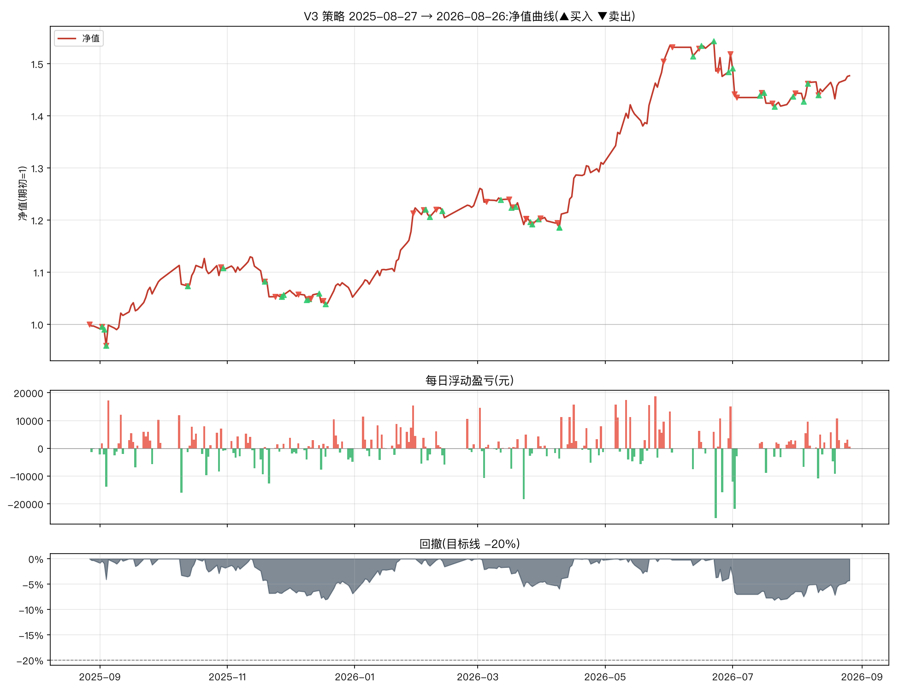

# V3 改良策略一年期报告(2025-08-27 → 2026-08-26)

参数:V3 = `n_hold=2, trailing_stop=0.08, min_momentum=0.0, take_profit=0.25`(其余同基础版默认)
初始资金:100,000 元 | 佣金:双边 0.0100% | 数据:akshare 前复权



## 核心指标

```
总收益率     : 47.71%
年化收益     : 50.36%
年化波动     : 18.20%
夏普比率     : 2.33
最大回撤     : -8.14%
卡玛比率     : 6.19
回测天数     : 242
```

- 期末市值:**649,571 元**(期初 439,760 元)
- 持仓天数占比:90.9%(其余为空仓/半仓)
- 往返交易(窗口内完成):35 笔,胜率 **37.1%**,平均持有 16.1 天
- 单笔最大盈利:+74,932 元 | 单笔最大亏损:-27,078 元

## 月度收益

| 月份      |     月收益 |
|:--------|--------:|
| 2025-08 |  -0.32% |
| 2025-09 |  +8.96% |
| 2025-10 |  +1.85% |
| 2025-11 |  -4.47% |
| 2025-12 |  -0.43% |
| 2026-01 | +16.28% |
| 2026-02 |  +0.35% |
| 2026-03 |  -1.96% |
| 2026-04 |  +8.61% |
| 2026-05 | +15.12% |
| 2026-06 |  +0.89% |
| 2026-07 |  -4.91% |
| 2026-08 |  +2.30% |

## 往返交易明细

| 买入日        | 卖出日        | 标的               |   买入价 |       卖出价 |                  份额 |     盈亏(元) |          收益率 |   持有天数 |
|:-----------|:-----------|:-----------------|------:|----------:|--------------------:|----------:|-------------:|-------:|
| 2025-08-26 | 2025-08-27 | 红利低波ETF(512890)  |    +1 |  +121.40% | 180114.96447253044  |   -900.57 | -0.00410172  |      1 |
| 2025-08-12 | 2025-09-02 | 纳指ETF(513100)    |    +2 |  +167.60% | 118450.68559949614  |  -3079.72 | -0.0152761   |     21 |
| 2025-09-02 | 2025-09-04 | 红利低波ETF(512890)  |    +1 |  +118.60% | 183045.11152569266  |  -1098.27 | -0.00503356  |      2 |
| 2025-09-04 | 2025-10-13 | 创业板50ETF(159949) |    +1 |  +139.40% | 158198.3135130704   |   3480.36 |  0.016035    |     39 |
| 2025-09-03 | 2025-10-29 | 黄金ETF(518880)    |    +8 |  +868.00% |  28117.238780750726 |  25867.9  |  0.118557    |     56 |
| 2025-10-13 | 2025-11-19 | 纳指ETF(513100)    |    +2 |  +183.50% | 122016.79333298128  |   3416.47 |  0.0154953   |     37 |
| 2025-11-19 | 2025-11-24 | 创业板50ETF(159949) |    +1 |  +139.40% | 154829.89968292517  |  -8205.98 | -0.0366275   |      5 |
| 2025-10-30 | 2025-11-27 | 红利低波ETF(512890)  |    +1 |  +120.10% | 205760.3346258668   |   3292.17 |  0.0135021   |     28 |
| 2025-11-28 | 2025-12-05 | 红利低波ETF(512890)  |    +1 |  +119.80% | 192376.74832284515  |   -961.88 | -0.00415628  |      7 |
| 2025-12-09 | 2025-12-10 | 纳指ETF(513100)    |    +2 |  +192.80% | 118286.0643360081   |  -2365.72 | -0.0102669   |      1 |
| 2025-12-10 | 2025-12-11 | 创业板50ETF(159949) |    +2 |  +153.20% | 148540.6665889062   |   -445.62 | -0.0019544   |      1 |
| 2025-12-15 | 2025-12-17 | 创业板50ETF(159949) |    +2 |  +146.20% | 150874.5295952284   |  -6940.23 | -0.030504    |      2 |
| 2025-11-27 | 2026-01-29 | 黄金ETF(518880)    |    +9 | +1191.80% |  25705.790095788372 |  74932.4  |  0.323781    |     63 |
| 2025-12-18 | 2026-02-03 | 创业板50ETF(159949) |    +2 |  +156.50% | 146925.0158304836   |   9403.2  |  0.0426382   |     47 |
| 2026-02-04 | 2026-02-09 | 创业板50ETF(159949) |    +2 |  +155.10% | 172853.64334238492  |      0    |  0           |      5 |
| 2026-02-12 | 2026-03-05 | 黄金ETF(518880)    |   +11 | +1098.00% |  25089.069453843975 |   6523.16 |  0.0242537   |     21 |
| 2026-03-12 | 2026-03-16 | 创业板50ETF(159949) |    +2 |  +155.80% | 173460.37954343983  |  -2948.83 | -0.0107937   |      4 |
| 2026-03-17 | 2026-03-18 | 创业板50ETF(159949) |    +2 |  +155.20% | 171374.32784090604  |  -6512.22 | -0.0238994   |      1 |
| 2026-02-06 | 2026-03-24 | 红利低波ETF(512890)  |    +1 |  +116.10% | 224742.61372382773  |  -4045.37 | -0.0152672   |     46 |
| 2026-03-19 | 2026-03-24 | 创业板50ETF(159949) |    +2 |  +155.80% | 172058.16326775402  |      0    |  0           |      5 |
| 2026-03-26 | 2026-03-27 | 创业板50ETF(159949) |    +2 |  +153.70% | 168973.48231178016  |  -4731.26 | -0.0178914   |      1 |
| 2026-03-30 | 2026-03-31 | 创业板50ETF(159949) |    +2 |  +154.20% | 170826.55262801953  |   1708.27 |  0.00652742  |      1 |
| 2026-03-27 | 2026-04-08 | 红利低波ETF(512890)  |    +1 |  +118.00% | 221702.11602360482  |   -443.4  | -0.00169205  |     12 |
| 2026-04-09 | 2026-05-29 | 创业板50ETF(159949) |    +2 |  +201.00% | 167281.42172485768  |  73603.8  |  0.280255    |     50 |
| 2026-04-09 | 2026-06-02 | 纳指ETF(513100)    |    +2 |  +235.50% | 143279.77747300957  |  74792    |  0.284779    |     54 |
| 2026-06-12 | 2026-06-15 | 创业板50ETF(159949) |    +2 |  +189.10% | 177523.67117706212  |  -1065.14 | -0.00316289  |      3 |
| 2026-06-16 | 2026-06-24 | 纳指ETF(513100)    |    +2 |  +215.40% | 148496.58355195337  | -16334.6  | -0.0485866   |      8 |
| 2026-06-29 | 2026-06-30 | 纳指ETF(513100)    |    +2 |  +221.10% | 147985.96568316972  |   7399.3  |  0.0231374   |      1 |
| 2026-07-01 | 2026-07-02 | 纳指ETF(513100)    |    +2 |  +219.30% | 146893.36955699723  |  -4994.37 | -0.0152672   |      1 |
| 2026-06-22 | 2026-07-03 | 创业板50ETF(159949) |    +2 |  +189.50% | 163122.88460049607  | -27078.4  | -0.0805434   |     11 |
| 2026-07-14 | 2026-07-15 | 纳指ETF(513100)    |    +2 |  +218.60% | 146297.81665828326  |   4242.64 |  0.0134446   |      1 |
| 2026-07-16 | 2026-07-20 | 纳指ETF(513100)    |    +2 |  +210.70% | 146519.24804878954  |  -8937.67 | -0.0281365   |      4 |
| 2026-07-30 | 2026-07-31 | 黄金ETF(518880)    |    +8 |  +846.00% |  37002.72038784167  |   -111.01 | -0.000354484 |      1 |
| 2026-08-04 | 2026-08-06 | 黄金ETF(518880)    |    +8 |  +888.00% |  37286.20550496479  |  18121.1  |  0.0578985   |      2 |
| 2026-07-21 | 2026-08-11 | 红利低波ETF(512890)  |    +1 |  +116.20% | 267424.4429054688   |  -2406.82 | -0.00768574  |     21 |

每日浮动盈亏明细见 `report_daily.csv`(共 242 个交易日);窗口相关委托流水(开仓回看 200 天)见 `report_trades.csv`。