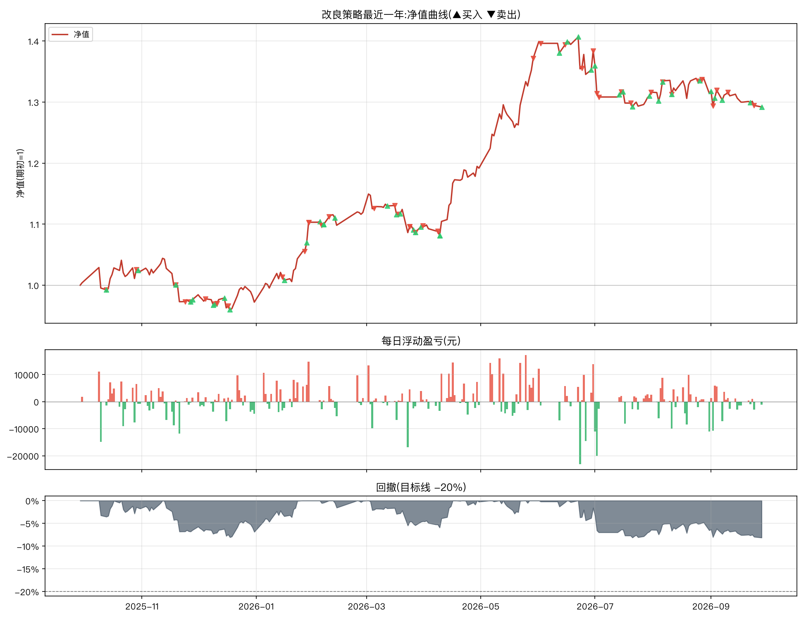

# 改良策略最近一年报告(2025-09-28 → 2026-09-28)

参数:V3 = `n_hold=2, trailing_stop=0.08, min_momentum=0.0, take_profit=0.25`(其余同原文默认)
初始资金:100,000 元 | 佣金:双边 0.0100% | 数据:akshare 前复权



## 核心指标

```
总收益率     : 29.20%
年化收益     : 30.72%
年化波动     : 17.13%
夏普比率     : 1.79
最大回撤     : -8.15%
卡玛比率     : 3.77
回测天数     : 241
```

- 期末市值:**573,233 元**(期初 443,678 元)
- 持仓天数占比:89.2%(其余为空仓/半仓)
- 往返交易(窗口内完成):41 笔,胜率 **39.0%**,平均持有 14.6 天
- 单笔最大盈利:+69,860 元 | 单笔最大亏损:-24,902 元

## 月度收益

| 月份      |     月收益 |
|:--------|--------:|
| 2025-09 |  +0.40% |
| 2025-10 |  +1.84% |
| 2025-11 |  -4.50% |
| 2025-12 |  -0.43% |
| 2026-01 | +13.46% |
| 2026-02 |  +1.44% |
| 2026-03 |  -1.96% |
| 2026-04 |  +8.61% |
| 2026-05 | +15.12% |
| 2026-06 |  +0.89% |
| 2026-07 |  -4.91% |
| 2026-08 |  -0.11% |
| 2026-09 |  -1.73% |

## 往返交易明细

| 买入日        | 卖出日        | 标的               |   买入价 |       卖出价 |                  份额 |     盈亏(元) |          收益率 |   持有天数 |
|:-----------|:-----------|:-----------------|------:|----------:|--------------------:|----------:|-------------:|-------:|
| 2025-09-04 | 2025-10-13 | 创业板50ETF(159949) |    +1 |  +139.40% | 148254.79805217643  |   3261.61 |  0.016035    |     39 |
| 2025-09-04 | 2025-10-29 | 黄金ETF(518880)    |    +8 |  +868.00% |  26094.36599455883  |  23093.5  |  0.113534    |     55 |
| 2025-10-13 | 2025-11-19 | 纳指ETF(513100)    |    +2 |  +183.50% | 114347.45828096782  |   3201.73 |  0.0154953   |     37 |
| 2025-11-19 | 2025-11-24 | 创业板50ETF(159949) |    +1 |  +139.40% | 144979.69766873718  |  -7683.92 | -0.0366275   |      5 |
| 2025-10-30 | 2025-11-27 | 红利低波ETF(512890)  |    +1 |  +120.10% | 191100.2525556076   |   3057.6  |  0.0135021   |     28 |
| 2025-11-28 | 2025-12-05 | 红利低波ETF(512890)  |    +1 |  +119.80% | 179354.44038456422  |   -896.77 | -0.00415628  |      7 |
| 2025-12-09 | 2025-12-10 | 纳指ETF(513100)    |    +2 |  +192.80% | 110279.08029027616  |  -2205.58 | -0.0102669   |      1 |
| 2025-12-10 | 2025-12-11 | 创业板50ETF(159949) |    +2 |  +153.20% | 138485.6972719695   |   -415.46 | -0.0019544   |      1 |
| 2025-12-15 | 2025-12-17 | 创业板50ETF(159949) |    +2 |  +146.20% | 140661.5771383382   |  -6470.43 | -0.030504    |      2 |
| 2025-12-18 | 2026-01-15 | 创业板50ETF(159949) |    +2 |  +155.70% | 136979.412649945    |   7670.85 |  0.0373085   |     28 |
| 2026-01-16 | 2026-01-27 | 创业板50ETF(159949) |    +2 |  +154.70% | 133438.23043781891  |  -6805.35 | -0.0319149   |     11 |
| 2025-11-27 | 2026-01-29 | 黄金ETF(518880)    |    +9 | +1191.80% |  23965.721624195354 |  69860.1  |  0.323781    |     63 |
| 2026-01-28 | 2026-01-29 | 创业板50ETF(159949) |    +2 |  +155.00% | 131540.89149974365  |  -2499.28 | -0.0121096   |      1 |
| 2026-02-04 | 2026-02-05 | 创业板50ETF(159949) |    +2 |  +153.80% | 157773.67977641942  |  -2051.06 | -0.00838169  |      1 |
| 2026-02-06 | 2026-02-09 | 创业板50ETF(159949) |    +2 |  +155.10% | 160829.82444621107  |   5789.87 |  0.0237624   |      3 |
| 2026-02-12 | 2026-03-05 | 黄金ETF(518880)    |   +11 | +1098.00% |  23072.907556485243 |   5998.96 |  0.0242537   |     21 |
| 2026-03-12 | 2026-03-16 | 创业板50ETF(159949) |    +2 |  +155.80% | 159521.02251123247  |  -2711.86 | -0.0107937   |      4 |
| 2026-03-17 | 2026-03-18 | 创业板50ETF(159949) |    +2 |  +155.20% | 157602.56746699574  |  -5988.9  | -0.0238994   |      1 |
| 2026-02-06 | 2026-03-24 | 红利低波ETF(512890)  |    +1 |  +116.10% | 206664.27823240863  |  -3719.96 | -0.0152672   |     46 |
| 2026-03-19 | 2026-03-24 | 创业板50ETF(159949) |    +2 |  +155.80% | 158245.24042967553  |      0    |  0           |      5 |
| 2026-03-26 | 2026-03-27 | 创业板50ETF(159949) |    +2 |  +153.70% | 155394.8945111088   |  -4351.06 | -0.0178914   |      1 |
| 2026-03-30 | 2026-03-31 | 创业板50ETF(159949) |    +2 |  +154.20% | 157099.05342630687  |   1570.99 |  0.00652742  |      1 |
| 2026-03-27 | 2026-04-08 | 红利低波ETF(512890)  |    +1 |  +118.00% | 203886.293050468    |   -407.77 | -0.00169205  |     12 |
| 2026-04-09 | 2026-05-29 | 创业板50ETF(159949) |    +2 |  +201.00% | 153838.80669890367  |  67689.1  |  0.280255    |     50 |
| 2026-04-09 | 2026-06-02 | 纳指ETF(513100)    |    +2 |  +235.50% | 131765.91735803534  |  68781.8  |  0.284779    |     54 |
| 2026-06-12 | 2026-06-15 | 创业板50ETF(159949) |    +2 |  +189.10% | 163257.99633390838  |   -979.55 | -0.00316289  |      3 |
| 2026-06-16 | 2026-06-24 | 纳指ETF(513100)    |    +2 |  +215.40% | 136563.50464351595  | -15022    | -0.0485866   |      8 |
| 2026-06-29 | 2026-06-30 | 纳指ETF(513100)    |    +2 |  +221.10% | 136093.91966030115  |   6804.7  |  0.0231374   |      1 |
| 2026-07-01 | 2026-07-02 | 纳指ETF(513100)    |    +2 |  +219.30% | 135089.12377489384  |  -4593.03 | -0.0152672   |      1 |
| 2026-06-22 | 2026-07-03 | 创业板50ETF(159949) |    +2 |  +189.50% | 150014.4466341194   | -24902.4  | -0.0805434   |     11 |
| 2026-07-14 | 2026-07-15 | 纳指ETF(513100)    |    +2 |  +218.60% | 134541.42907981333  |   3901.7  |  0.0134446   |      1 |
| 2026-07-16 | 2026-07-20 | 纳指ETF(513100)    |    +2 |  +210.70% | 134745.0664026548   |  -8219.45 | -0.0281365   |      4 |
| 2026-07-30 | 2026-07-31 | 黄金ETF(518880)    |    +8 |  +846.00% |  34029.208326801716 |   -102.09 | -0.000354484 |      1 |
| 2026-08-04 | 2026-08-06 | 黄金ETF(518880)    |    +8 |  +888.00% |  34289.91278331245  |  16664.9  |  0.0578985   |      2 |
| 2026-07-21 | 2026-08-11 | 红利低波ETF(512890)  |    +1 |  +116.20% | 245934.40654972065  |  -2213.41 | -0.00768574  |     21 |
| 2026-08-06 | 2026-08-25 | 纳指ETF(513100)    |    +2 |  +215.90% | 131615.39062003992  | -11055.7  | -0.0374498   |     19 |
| 2026-08-26 | 2026-08-27 | 纳指ETF(513100)    |    +2 |  +222.80% | 129555.88660303211  |   4145.79 |  0.0145719   |      1 |
| 2026-09-01 | 2026-09-02 | 纳指ETF(513100)    |    +2 |  +220.40% | 130113.97120603717  |  -1821.6  | -0.00631199  |      1 |
| 2026-09-03 | 2026-09-04 | 纳指ETF(513100)    |    +2 |  +222.50% | 130265.26177524318  |   3126.37 |  0.0109041   |      1 |
| 2026-08-11 | 2026-09-10 | 黄金ETF(518880)    |    +9 |  +906.00% |  32260.121501825997 |  -2258.21 | -0.00766703  |     30 |
| 2026-09-07 | 2026-09-24 | 红利低波ETF(512890)  |    +1 |  +118.10% | 240283.78300732025  |  -6007.09 | -0.0207297   |     17 |

每日浮动盈亏明细见 `report_1y_daily.csv`(共 241 个交易日);全部委托流水见 `report_1y_trades.csv`。